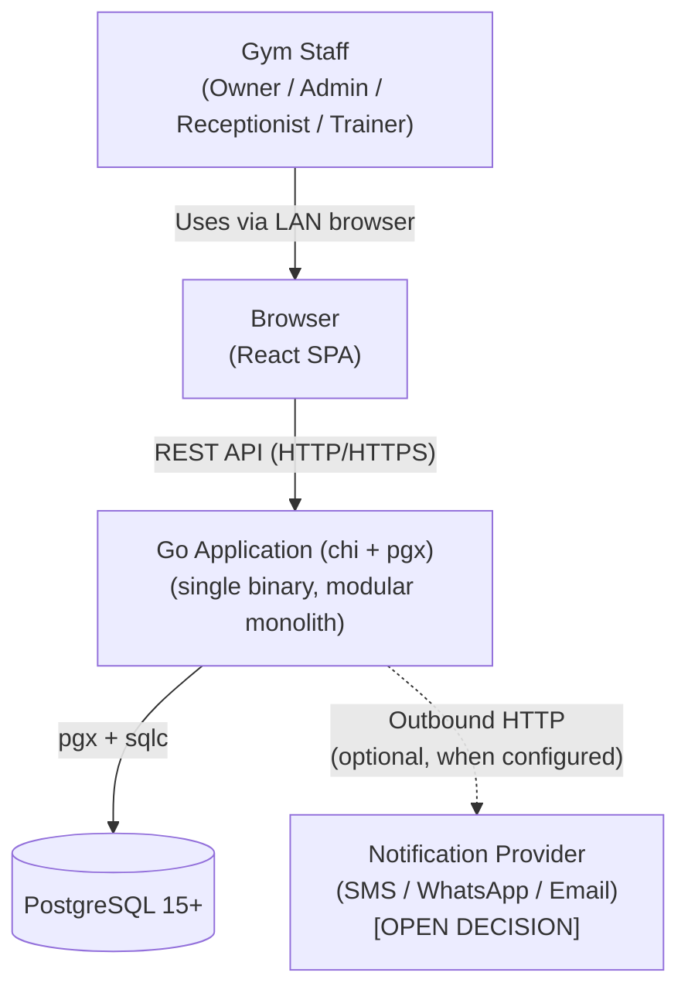
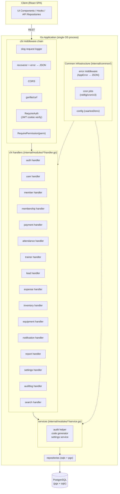
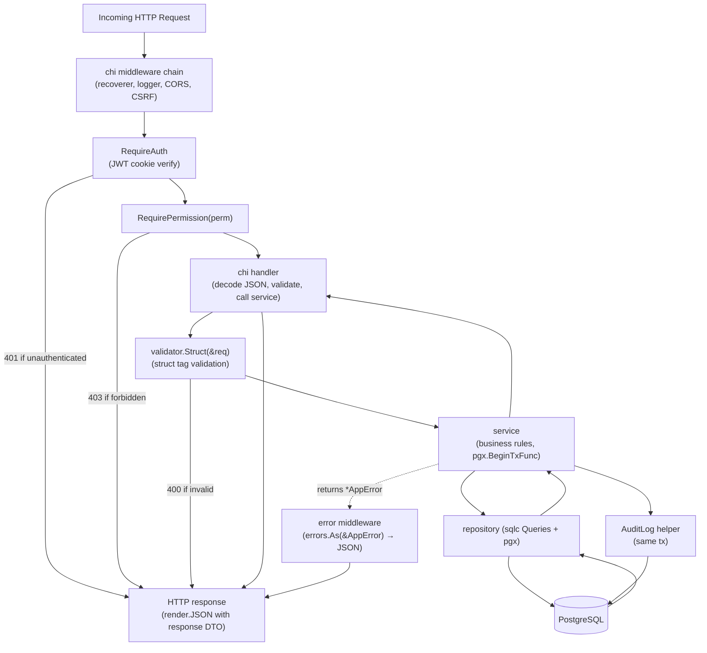
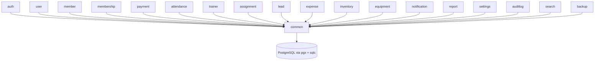
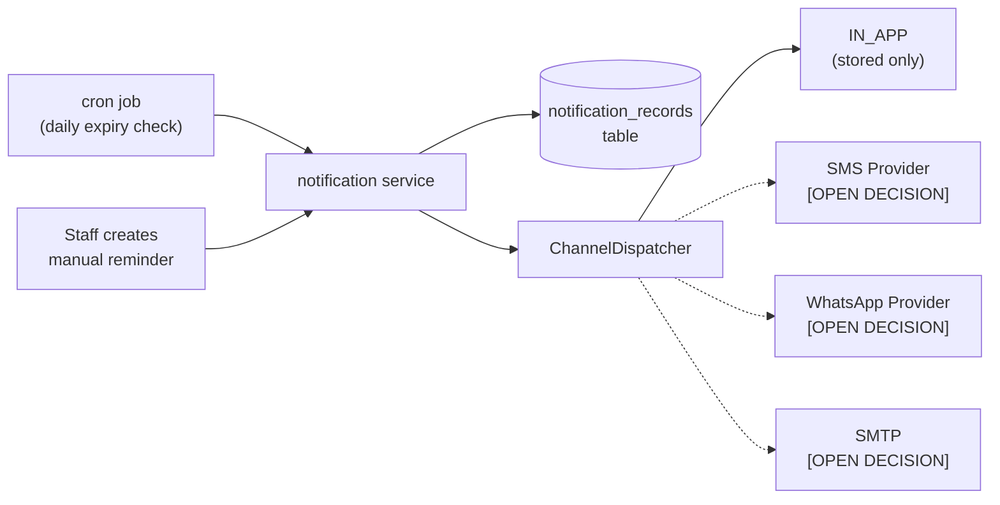

# 02 — System Architecture

## Technology Baseline

| Concern | Technology |
|---|---|
| Language | Go 1.23+ |
| HTTP router | chi (`go-chi/chi/v5`) |
| Architecture | Modular monolith (single binary) |
| API style | REST |
| DB driver | pgx v5 (`jackc/pgx/v5`) with `pgxpool` |
| SQL layer | sqlc (`sqlc-dev/sqlc`) — generated type-safe query functions |
| Database | PostgreSQL 15+ |
| Migration tool | goose (`pressly/goose`) — SQL migrations, CLI-triggered |
| Authentication | `golang-jwt/jwt/v5` delivered via httpOnly, SameSite=Strict cookie; CSRF via `gorilla/csrf` |
| Validation | `go-playground/validator/v10` struct tags on DTOs |
| Scheduler | `robfig/cron/v3` |
| Logging | `log/slog` (stdlib) — JSON in prod, text in dev |
| Config | `caarlos0/env/v11` parsing env vars into a typed `Config` struct |
| Testing | stdlib `testing` + `stretchr/testify` + `net/http/httptest` + `testcontainers-go/modules/postgres` |
| Build | `go build -o gym-backend ./cmd/server` — single static binary (~20 MB) |

---

## Architecture Decision: Modular Monolith

This system is a **modular monolith**. All features run inside a single Go process. Module boundaries are enforced through Go's `internal/` import rules and package-by-feature conventions, not network calls.

**Rationale:**

| Factor | Justification |
|---|---|
| Scale | Single gym, ~500 active members, ~10 concurrent users, 1–5 RPS peak. No multi-tenant, no high-traffic requirements. |
| Deployment | Runs on a local LAN machine (owner's Windows PC or a Linux box). A single ~20 MB binary is far simpler to deploy, restart, and manage than multiple processes. |
| Transactions | Business operations frequently span multiple tables (membership + payment + audit). A single process using one `pgxpool` makes transactions trivial — `pgx.BeginTxFunc` over the whole operation. |
| Team | Small team or single developer. Microservices would add coordination overhead with no benefit. |
| Go fit | Go compiles to a static binary with no runtime dependency, fast startup (<100 ms), and a small memory footprint (~30–60 MB resident). It fits the local-LAN target precisely because it is small and self-contained, not because it is "cloud-native". |

Microservices, CQRS, event sourcing, and message queues are explicitly **not** used. They add complexity without benefit at this scale.

---

## System Context Diagram



The notification provider connection is optional. The system must function fully without it.
All communication happens on the local network.

---

## Go Application Architecture



---

## Request Processing Pipeline



---

## Module Map

Each feature module is a Go package under `internal/modules/`. The `internal/` directory prevents external import. The top-level layout follows the Go standard project layout:

```
backend/
├── cmd/
│   └── server/
│       └── main.go                 ← entry: load config, build app, http.ListenAndServe
├── internal/
│   ├── app/                        ← builds chi router with routes/middleware; returns *http.Server
│   ├── config/                     ← env-parsed Config struct
│   ├── db/                         ← pgxpool, migrations/, queries/, sqlc/
│   ├── middleware/                 ← auth, logger, csrf, cors, errorhandler
│   ├── common/                     ← shared helpers (no domain logic)
│   │   ├── errors.go               ← AppError + constructors
│   │   ├── pagination.go           ← PageResponse[T], ParsePageQuery
│   │   ├── codegen.go              ← Next*Code helpers (pg sequences)
│   │   ├── audit.go                ← AuditLog(ctx, tx, entry)
│   │   ├── permissions.go          ← Role → []Permission map
│   │   └── scheduler.go            ← cron.Cron wrapper
│   └── modules/                    ← feature packages
│       ├── auth/
│       ├── user/
│       ├── member/
│       ├── membershipplan/
│       ├── membership/
│       ├── payment/
│       ├── attendance/
│       ├── trainer/
│       ├── assignment/
│       ├── lead/
│       ├── expense/
│       ├── inventory/
│       ├── equipment/
│       ├── notification/
│       ├── report/
│       ├── settings/
│       ├── auditlog/
│       ├── search/
│       └── backup/
├── sqlc.yaml                       ← sqlc config
├── go.mod
├── go.sum
├── .env.example
└── .gitignore
```

**Package-by-feature** is used rather than package-by-layer. For a modular monolith, package-by-feature keeps all code for a given domain in one place (handler, service, repository, DTO). This makes features easier to understand and maintain, and makes potential future extraction straightforward.

---

## Internal Package Structure Per Module

Each feature module follows this consistent internal structure:

```
internal/modules/member/
├── handler.go       ← chi.Router, HTTP decode/encode, calls service
├── service.go       ← business logic, transactions, calls audit
├── repository.go    ← wraps sqlc Queries + hand-written queries where needed
└── dto.go           ← request/response structs with json + validate tags
```

The sqlc-generated Go code lives in `internal/db/sqlc/` and is imported by each module's repository. SQL query sources live in `internal/db/queries/<module>.sql`.

---

## Module Dependency Rules

Modules depend only on `internal/common` and `internal/db`. No module imports from another module's service or repository.



**Cross-module data access** (e.g., the reports module needs payment data) goes via SQL queries, not by importing another module's service. The `internal/common` package provides shared utilities (pagination, audit, code generation) available to all modules.

**Explicit exceptions** (documented, not undocumented):
- `report` module queries multiple tables directly — it has its own read-only query methods that span domains.
- `search` module queries multiple tables for global search.
- `notification` module queries `memberships` and `members` tables to compute expiry lists.

---

## Database

**PostgreSQL 15+** is the chosen engine. Rationale:
- Full constraint support (CHECK, partial indexes, FK).
- `pg_dump` for offline backup.
- Native JSON for the audit log metadata column.
- Excellent `pgx` driver — direct wire protocol, no cgo.

Connection pooling via `pgxpool.New(ctx, DATABASE_URL)` configured during app startup. Pool size defaults are fine; this system does not stress Postgres.

**Migrations** are owned by **goose**. SQL files live in `internal/db/migrations/`:

```
001_init.sql
002_seed_settings.sql
003_code_sequences.sql
...
```

Migrations are applied with `goose up` **before** starting the application — not on app boot. The server binary assumes the schema is current; schema divergence is caught at the sqlc generation step, not at runtime.

---

## Background Jobs

`robfig/cron/v3` is used for scheduled work. A single `cron.Cron` instance is constructed during app build and started alongside the HTTP server. No external job queue is needed.

| Job | Schedule |
|---|---|
| Expire memberships (update ACTIVE → EXPIRED where `end_date < today`) | Daily at midnight IST (`0 0 * * *`) |
| Send expiry notifications | Daily at 9 AM IST (`0 9 * * *`) |
| Daily `pg_dump` backup | 2 AM IST (`0 2 * * *`) |

All jobs run inside the same OS process using the same `pgxpool`. A dedicated message queue (RabbitMQ, Kafka, NATS) is **not** used.

---

## Notification Architecture



In-app is always available. External channels require configuration. The system starts with IN_APP only and adds channels when a provider is chosen.

---

## Backup and Restore Architecture

**Recommendation:** `pg_dump` subprocess invoked from the backup service via `os/exec`. The backup endpoint (`POST /api/v1/backup/create`) is restricted to OWNER.

**Note:** The backup/restore frontend UI is **not yet implemented**. The backend API should be designed and implemented; frontend integration is a separate task.

---

## Important Architectural Decisions

### Transaction Boundaries

All mutations that span multiple tables run inside a single `pgx.BeginTxFunc` block in the service layer. The audit log write is included in the same transaction as the primary operation. The sqlc `Queries` struct is instantiated per transaction (`sqlc.New(tx)`) so all queries in the block share the same connection and transaction.

### Business Logic Location

- **Handlers:** Decode JSON, validate DTO, call service, encode response. No business logic.
- **Services:** All business rules, validation beyond schema, transactions, audit logging. Take `context.Context` as the first argument and propagate it.
- **Repositories:** sqlc query calls and hand-written SQL only. No business logic.
- **DTOs:** struct tags for JSON and validation. No methods beyond trivial accessors.

### Authorization Model

Frontend permission checks are UX (hiding buttons). Backend `RequirePermission(perm)` middleware is the actual security boundary. Every protected endpoint enforces authorization server-side, independently of the frontend.

### API Versioning

All endpoints use `/api/v1/` prefix. The chi router mounts the v1 subrouter under this prefix. Future breaking changes can live under `/api/v2/` without disrupting existing clients.

### Frontend Serving

The Go server serves the compiled React SPA from an embedded `embed.FS` or a configured static directory using `http.FileServer`. Single process, single port. For a LAN gym system this is operationally simpler than running a separate static server. No reverse proxy is required on the gym LAN.
