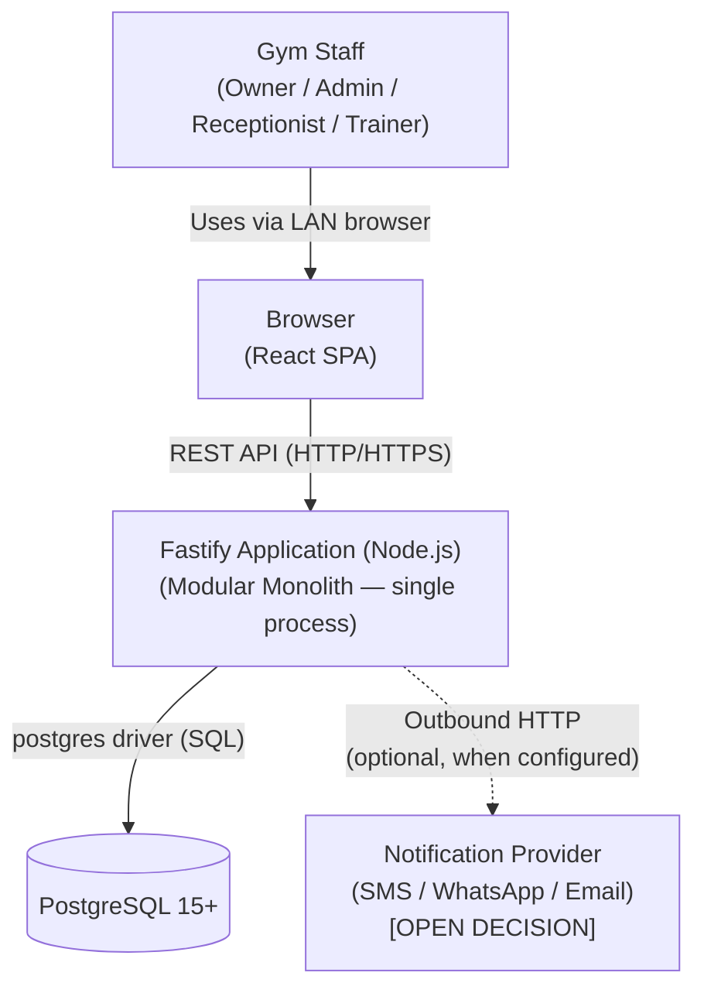
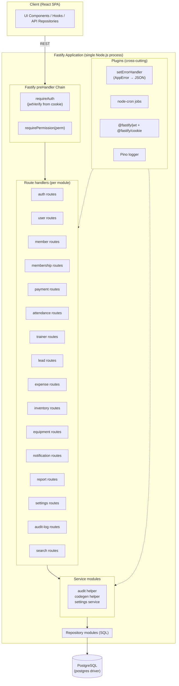
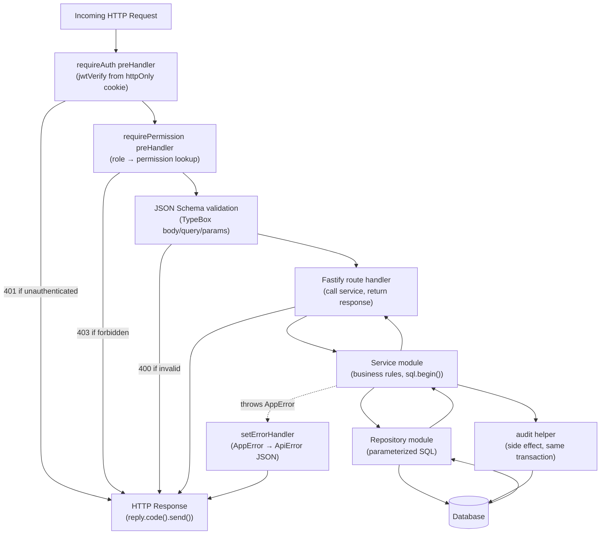
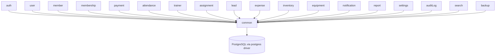
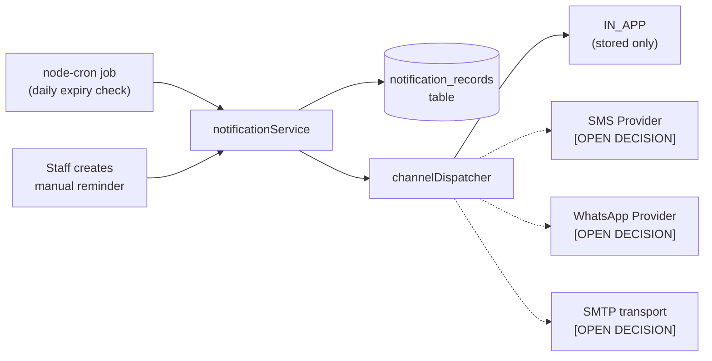

# 02 — System Architecture

## Technology Baseline

| Concern | Technology |
|---|---|
| Runtime | Node.js 22 LTS |
| Language | TypeScript 5 (ESM, `"module": "NodeNext"`) |
| Framework | Fastify 5.x |
| Architecture | Modular Monolith |
| API style | REST |
| Persistence | `postgres` (porsager/postgres) — tagged-template SQL, no ORM |
| Database | PostgreSQL 15+ |
| Migration tool | `node-pg-migrate` (SQL-first versioned files) |
| Authentication | `@fastify/jwt` + `@fastify/cookie` (signed JWT delivered via httpOnly cookie) |
| API documentation | `@fastify/swagger` + `@fastify/swagger-ui` (OpenAPI auto-generated from route JSON Schemas) |
| Testing | Vitest + `app.inject()` + Testcontainers (`@testcontainers/postgresql`) |
| Package manager | pnpm |
| Build | `tsc` → `dist/`; dev loop via `tsx watch src/server.ts` |

---

## Architecture Decision: Modular Monolith

This system is a **Modular Monolith**. All modules run inside a single Fastify process. Module boundaries are enforced through directory conventions and import rules, not network calls.

**Rationale:**

| Factor | Justification |
|---|---|
| Scale | Single gym, ~500 active members, ~10 concurrent staff, ~1–5 RPS peak. No multi-tenant, no high-traffic requirements. |
| Deployment | Runs on a local LAN machine. A single Node process is far simpler to deploy, restart, and manage than multiple services. |
| Transactions | Business operations frequently span multiple tables (membership + payment + audit). A single `sql.begin()` transaction inside one process is simple and reliable. |
| Team | Small team or single developer. Microservices would add coordination overhead with no benefit. |
| Fastify fit | Fastify is small, fast, and schema-driven. It fits a modular monolith well because plugins encapsulate feature slices without network complexity. |

Microservices, CQRS, event sourcing, and message brokers are explicitly **not** used. They add complexity without benefit at this scale.

---

## System Context Diagram



The notification provider connection is optional. The system must function fully without it.
All communication happens on the local network.

---

## Fastify Application Architecture



---

## Request Processing Pipeline



---

## Module Map

Each feature module lives in its own directory under `src/modules/`. Shared infrastructure lives under `src/common/` and `src/plugins/`.

```
backend/
├── src/
│   ├── server.ts                   ← bootstrap, builds the Fastify app, listens
│   ├── app.ts                      ← builds and registers all plugins/routes (test-friendly: returns app without .listen())
│   ├── config/
│   │   └── env.ts                  ← env-schema definition + typed export
│   ├── db/
│   │   ├── client.ts               ← creates and exports the postgres client (singleton)
│   │   └── migrations/             ← 001_init.sql, 002_..., ...
│   ├── plugins/                    ← cross-cutting Fastify plugins
│   │   ├── auth.ts                 ← @fastify/jwt + @fastify/cookie + decorators (requireAuth, requirePermission)
│   │   ├── cors.ts
│   │   ├── error-handler.ts        ← setErrorHandler mapping AppError → JSON response
│   │   ├── logger.ts               ← Pino config
│   │   └── scheduler.ts            ← registers node-cron jobs at startup
│   ├── common/
│   │   ├── errors.ts               ← AppError, NotFoundError, ConflictError, BusinessRuleError, etc.
│   │   ├── pagination.ts           ← PageResponse<T>, parsePageQuery helper
│   │   ├── codegen.ts              ← nextMemberCode, nextUserCode, etc. (Postgres sequences)
│   │   ├── audit.ts                ← auditLog() helper, called inside sql.begin()
│   │   └── permissions.ts          ← role → permissions map (mirrors frontend)
│   └── modules/
│       ├── auth/                   ← login, logout, current-user, profile update
│       ├── user/                   ← user management CRUD
│       ├── member/                 ← member CRUD + supplemental data
│       ├── membershipPlan/         ← plan CRUD
│       ├── membership/             ← membership lifecycle
│       ├── payment/                ← payment recording
│       ├── attendance/             ← check-in marking
│       ├── trainer/                ← trainer management
│       ├── assignment/             ← member-trainer assignments
│       ├── lead/                   ← lead pipeline + conversion
│       ├── expense/                ← expense + category management
│       ├── inventory/              ← inventory items + transactions
│       ├── equipment/              ← equipment + maintenance
│       ├── notification/           ← notification records + dispatch
│       ├── report/                 ← aggregated reporting queries
│       ├── settings/               ← gym configuration singleton
│       ├── auditLog/               ← audit log API (read-only)
│       ├── search/                 ← global cross-entity search
│       └── backup/                 ← backup and restore [OPEN DECISION: frontend UI pending]
```

**Package-by-feature** is used rather than package-by-layer (e.g., a top-level `routes/` directory containing all route files).

**Rationale:** For a modular monolith, package-by-feature keeps all code for a given domain in one place (routes, service, repository, schemas). This makes features easier to understand and maintain. It also makes potential future extraction to a separate service straightforward.

---

## Internal Directory Structure Per Module

Each feature module follows this consistent internal structure:

```
src/modules/member/
├── routes.ts                 ← Fastify plugin registering /members/* routes with TypeBox schemas
├── service.ts                ← business logic + sql.begin() transactions
├── repository.ts             ← SQL queries using the postgres client
├── schemas.ts                ← TypeBox: CreateMemberRequest, UpdateMemberRequest, MemberResponse (export types too)
└── errors.ts                 ← domain-specific errors (e.g., MemberPhoneDuplicateError extends ConflictError)
```

Routes are registered as Fastify plugins. `app.register(memberRoutes, { prefix: '/api/v1/members' })` wires the module into the app.

---

## Module Dependency Rules

Modules depend only on `common/`, `plugins/`, `config/`, and `db/`. No module imports from another module's service or repository.



**Cross-module data access** (e.g., the reports module needs payment data) must go via direct SQL queries, not by importing another module's service. The `common/` directory provides shared utilities (pagination, audit, codegen) available to all modules.

**Explicit exceptions** (documented, not undocumented):
- `report` module queries multiple tables directly — it has its own read-only SQL that spans domains.
- `search` module queries multiple tables for global search.
- `notification` module queries `memberships` and `members` tables to compute expiry lists.

---

## Database

PostgreSQL 15+. The `postgres` driver (porsager/postgres) is used for all SQL access — no ORM. Queries are written as tagged templates with automatic parameter binding, which gives:

- Type-safe parameter substitution (no SQL injection risk).
- First-class support for arrays, JSONB, `RETURNING`, and transactions.
- A thin surface area — much less to learn than Hibernate/JPA.

Development can use the same PostgreSQL instance (via Docker Compose) rather than an in-memory substitute; integration tests use Testcontainers to spin up a real Postgres per test suite. This avoids H2-style drift where constraints behave differently in test vs production.

### Migrations

`node-pg-migrate` is used for versioned SQL migrations. Files are plain SQL named sequentially:

```
src/db/migrations/
├── 001_init.sql                 ← all tables, enums, indexes, constraints
├── 002_seed_settings.sql        ← inserts the gym_settings row (id = 1)
└── 003_...
```

Migrations are **forward-only** in production. They are applied via a CLI command (`pnpm migrate up`) separate from app startup — the Fastify process does not auto-run migrations on boot.

---

## Background Jobs

`node-cron` scheduled inside a Fastify plugin registered at startup is sufficient for v1 scheduled work. No external job queue is needed.

| Job | Schedule |
|---|---|
| Expire memberships (update ACTIVE → EXPIRED where `end_date < today`) | Daily at midnight IST |
| Send expiry notifications | Daily at 9 AM IST |

Both jobs run within the same Node process. They are registered in `plugins/scheduler.ts` and share the same `postgres` client and services as HTTP request handlers.

A dedicated message queue (RabbitMQ, Kafka, BullMQ) is **not** used. The gym's operational volume does not justify asynchronous job infrastructure.

---

## Notification Architecture



In-app is always available. External channels require configuration. The system starts with IN_APP only and adds channels when a provider is chosen.

---

## Backup and Restore Architecture

**Recommended:** `pg_dump` invoked as a subprocess from a Fastify route handler using Node's `child_process.spawn`. The backup endpoint (`POST /api/v1/backup/create`) is restricted to OWNER.

**Note:** The backup/restore frontend UI is **not yet implemented**. The backend API should be designed and implemented; frontend integration is a separate task.

---

## Important Architectural Decisions

### Transaction Boundaries

All mutations that span multiple tables must run inside a single `sql.begin(async (tx) => { ... })` block in the service layer. The audit log write is included in the same transaction as the primary operation.

### Business Logic Location

- **Route handlers:** Parse request, call service, return response. No business logic.
- **Services:** All business rules, validation beyond schema, transactions, audit logging.
- **Repositories:** SQL queries and mutations only. No business logic.
- **Schemas:** TypeBox definitions for request/response validation and OpenAPI generation. No logic.

### Authorization Model

Frontend permission checks are UX (hiding buttons). Backend `preHandler: [app.requireAuth, app.requirePermission('...')]` is the actual security boundary. Every protected endpoint enforces authorization server-side, independently of the frontend.

### API Versioning

All endpoints use `/api/v1/` prefix. This allows future breaking changes under `/api/v2/` without disrupting existing clients.

### Frontend Serving

The React SPA is served as static files by Fastify using `@fastify/static` pointing at `frontend/dist/`. Single process, single port. For a LAN gym system this is the simplest operational setup; a separate Nginx is unnecessary at this scale.
