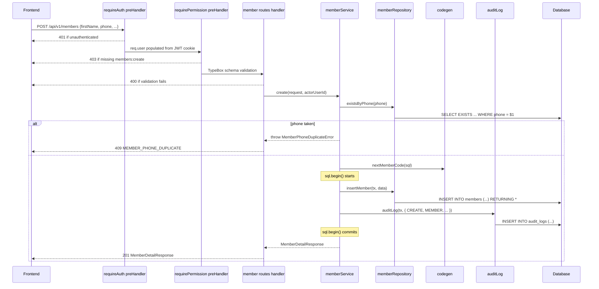
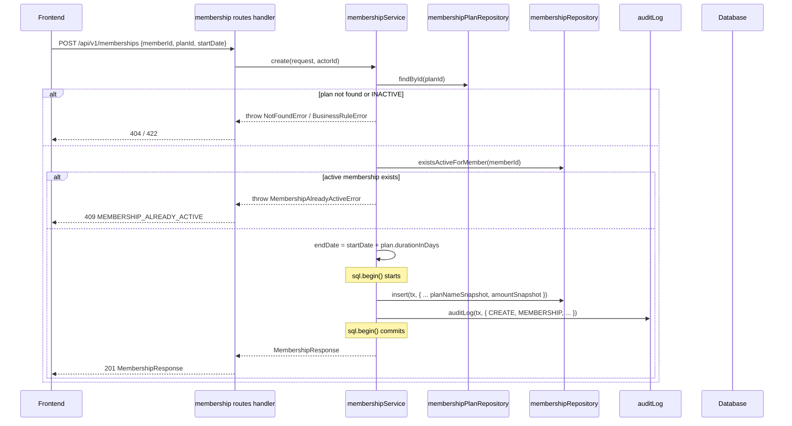
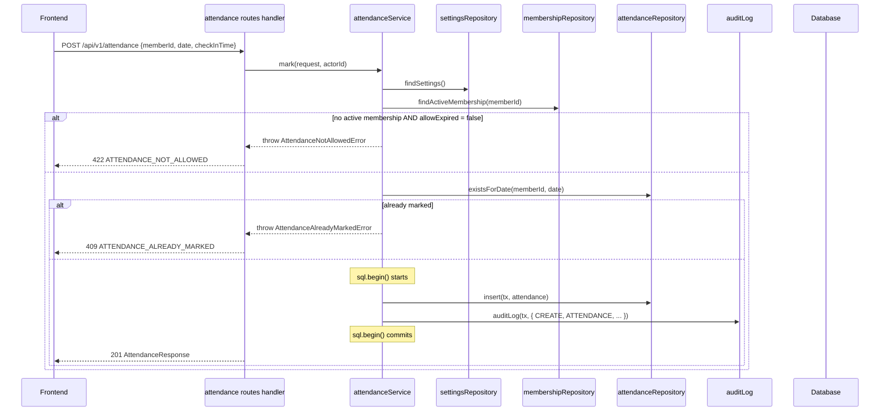
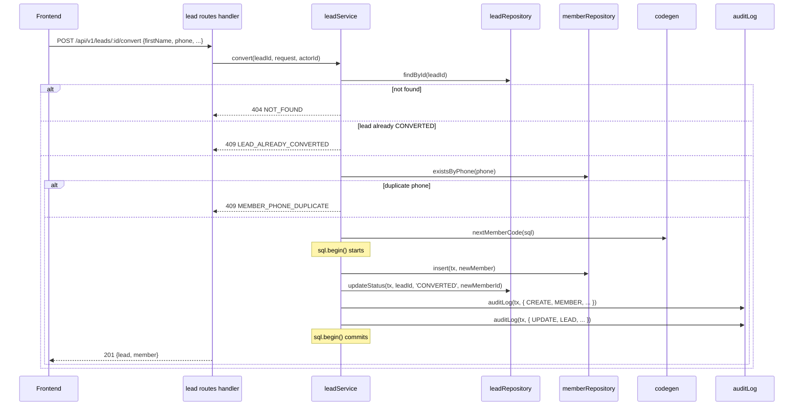
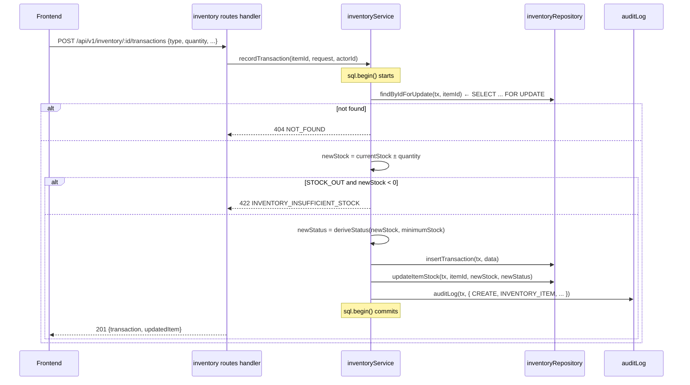

# 06 — Backend Low-Level Design (LLD)

## Technology

| Layer | Technology |
|---|---|
| Runtime | Node.js 22 LTS |
| Language | TypeScript 5 (ESM, `"module": "NodeNext"`) |
| Framework | Fastify 5.x |
| Persistence | `postgres` (porsager/postgres) — tagged-template SQL, no ORM |
| Validation | TypeBox schemas registered on Fastify routes (JSON Schema at the boundary) |
| Auth | `@fastify/jwt` + `@fastify/cookie` + `@fastify/csrf-protection` |
| Scheduler | `node-cron` registered inside a Fastify plugin |
| Logging | Pino (built into Fastify) + `pino-roll` in production |
| Testing | Vitest + `app.inject()` + Testcontainers (`@testcontainers/postgresql`) |
| Build | `tsc` to emit `dist/`; dev loop via `tsx watch src/server.ts` |
| Package manager | pnpm |

---

## Directory Structure

### Strategy: Package-by-Feature

The backend uses **package-by-feature** rather than package-by-layer.

**Why:** A package-by-layer layout (e.g., top-level `routes/`, `services/`, `repositories/` containing all route files/services) puts unrelated code together and related code apart. For a modular monolith, package-by-feature keeps all files for a single domain concern in one place — making each feature independently understandable.

```
backend/
├── src/
│   ├── server.ts                             ← bootstrap, builds the app, listens
│   ├── app.ts                                ← builds and registers all plugins/routes (returns the Fastify instance; no .listen() so tests can call app.inject())
│   │
│   ├── config/
│   │   └── env.ts                            ← env-schema definition + typed export
│   │
│   ├── db/
│   │   ├── client.ts                         ← creates and exports the postgres client (singleton)
│   │   └── migrations/
│   │       ├── 001_init.sql
│   │       ├── 002_seed_settings.sql
│   │       └── 003_code_sequences.sql
│   │
│   ├── plugins/                              ← cross-cutting Fastify plugins
│   │   ├── auth.ts                           ← @fastify/jwt + @fastify/cookie; decorates app.requireAuth, app.requirePermission
│   │   ├── cors.ts
│   │   ├── csrf.ts                           ← @fastify/csrf-protection (cookie-JWT needs CSRF)
│   │   ├── error-handler.ts                  ← setErrorHandler mapping AppError → JSON response
│   │   ├── logger.ts                         ← Pino config
│   │   ├── scheduler.ts                      ← registers node-cron jobs at startup
│   │   └── swagger.ts                        ← @fastify/swagger + @fastify/swagger-ui
│   │
│   ├── common/                               ← shared infrastructure; no domain logic
│   │   ├── errors.ts                         ← AppError base + NotFoundError / ConflictError / BusinessRuleError / ForbiddenError
│   │   ├── pagination.ts                     ← PageResponse<T>, parsePageQuery helper
│   │   ├── codegen.ts                        ← nextMemberCode(), nextUserCode(), ... (Postgres sequences)
│   │   ├── audit.ts                          ← auditLog(tx, { ... }) helper, called inside sql.begin()
│   │   ├── audit-types.ts                    ← AuditAction, AuditEntityType, AuditStatus enums (as string literal unions)
│   │   ├── permissions.ts                    ← role → permissions map (mirrors frontend)
│   │   └── types.ts                          ← shared Fastify module augmentation (req.user, decorators)
│   │
│   └── modules/
│       ├── auth/
│       │   ├── routes.ts                     ← POST /login, POST /logout, GET /me, PATCH /profile
│       │   ├── service.ts                    ← login(), logout(), getCurrentUser()
│       │   ├── schemas.ts                    ← LoginRequest, AuthUserResponse
│       │   └── errors.ts                     ← AuthInvalidCredentialsError, AuthAccountInactiveError
│       │
│       ├── user/
│       │   ├── routes.ts
│       │   ├── service.ts
│       │   ├── repository.ts
│       │   ├── schemas.ts                    ← CreateUserRequest, UpdateUserRequest, UserResponse
│       │   └── types.ts                      ← UserRole, UserStatus string unions
│       │
│       ├── member/
│       │   ├── routes.ts
│       │   ├── service.ts
│       │   ├── repository.ts
│       │   ├── schemas.ts                    ← CreateMemberRequest, UpdateMemberRequest, MemberListItemResponse, MemberDetailResponse
│       │   └── errors.ts                     ← MemberPhoneDuplicateError
│       │
│       ├── membershipPlan/
│       │   ├── routes.ts
│       │   ├── service.ts
│       │   ├── repository.ts
│       │   └── schemas.ts
│       │
│       ├── membership/
│       │   ├── routes.ts
│       │   ├── service.ts
│       │   ├── repository.ts
│       │   ├── schemas.ts
│       │   └── errors.ts                     ← MembershipAlreadyActiveError
│       │
│       ├── payment/
│       │   ├── routes.ts
│       │   ├── service.ts
│       │   ├── repository.ts
│       │   └── schemas.ts
│       │
│       ├── attendance/
│       │   ├── routes.ts
│       │   ├── service.ts
│       │   ├── repository.ts
│       │   ├── schemas.ts
│       │   └── errors.ts                     ← AttendanceAlreadyMarkedError, AttendanceNotAllowedError
│       │
│       ├── trainer/                          ← routes, service, repository, schemas
│       ├── assignment/                       ← routes (nested under /members/:id/trainer), service, repository, schemas
│       ├── lead/                             ← routes, service, repository, schemas, errors (LeadAlreadyConvertedError)
│       ├── expense/                          ← routes (both /expenses and /expense-categories), service, repository, schemas
│       ├── inventory/                        ← routes, service, repository, schemas, errors (InsufficientStockError)
│       ├── equipment/                        ← routes, service, repository, schemas
│       ├── notification/                     ← routes, service, repository, schemas; scheduler jobs live in plugins/scheduler.ts and call this module's service
│       ├── report/                           ← routes, service, repository (read-only aggregation SQL), schemas
│       ├── settings/                         ← routes, service, repository, schemas
│       ├── auditLog/                         ← routes (read-only), repository, schemas
│       ├── search/                           ← routes, service, schemas
│       └── backup/                           ← routes, service (invokes pg_dump via child_process)
│
├── test/
├── package.json
├── tsconfig.json
├── .env.example
└── .gitignore
```

---

## Layer Responsibilities

### Route handler (`routes.ts`)

- Registered as a `FastifyPluginAsyncTypebox`.
- Declares the HTTP method, path, TypeBox request/response schemas, and `preHandler` chain.
- Handler body parses `req.body` / `req.query` / `req.params` (already type-narrowed by TypeBox), calls the service, returns the response via `reply.code(...).send(...)` (or an implicit return).
- **No business logic**.
- **No direct repository calls**.
- Authorization is wired via `preHandler: [app.requireAuth, app.requirePermission('members:create')]` on the route definition.

### Service (`service.ts`)

- Contains all business logic, domain rules, and workflow orchestration.
- Manages database transactions via `sql.begin(async (tx) => { ... })`.
- Calls repository functions and maps rows to response shapes.
- Calls the `auditLog(tx, { ... })` helper to record significant actions inside the same transaction.
- Throws domain errors (`NotFoundError`, `ConflictError`, etc.) — the error handler plugin converts them to HTTP responses.

### Repository (`repository.ts`)

- Thin SQL layer using the `postgres` client.
- Each function is a parameterized SQL query returning plain rows (or arrays of rows).
- **No business logic**.
- Accepts either the top-level `sql` client (for standalone reads) or a `tx` handle (when called from within `sql.begin()`), so repositories compose into service-level transactions.

### Schemas (`schemas.ts`)

- TypeBox definitions for every request body, query string, and response.
- Each schema is both the runtime validator (registered on the route) and the static TypeScript type (`type X = Static<typeof X>`).
- No logic — just shape.

---

## Request/Response Flow

Fastify entities are **never** exposed as raw DB rows at the HTTP boundary. The flow is:

```
Incoming JSON
    ↓
Route handler    (Fastify validates body/query/params against TypeBox schema)
    ↓                 400 if invalid
    ↓
Service          (business rules, maps request → DB insert, applies rules)
    ↓
Repository       (parameterized SQL via postgres driver)
    ↓
Database

Database
    ↓
Repository       (returns row(s))
    ↓
Service          (maps row(s) → response shape)
    ↓
Route handler    (reply.code().send() — response is validated against TypeBox response schema)
    ↓
Response JSON
```

Fastify's response schema validation (if enabled with `response: { 201: ... }` in the schema) also strips unexpected fields, preventing accidental leakage of sensitive columns like `password_hash`.

### Schema Naming Convention

| Type | Suffix | Example |
|---|---|---|
| Create input | `CreateXxxRequest` | `CreateMemberRequest` |
| Update input | `UpdateXxxRequest` | `UpdateMemberRequest` |
| List view output | `XxxListItemResponse` | `MemberListItemResponse` |
| Detail view output | `XxxDetailResponse` or `XxxResponse` | `MemberDetailResponse` |
| Nested sub-object | `XxxSummary` or `XxxInfo` | `MembershipSummary` |

### Mapping Strategy

Manual mapping from SQL row to response object. No ORM, no automatic mapping library — the mapping is a plain function in the service file:

```ts
function toMemberResponse(row: MemberRow): MemberResponse {
  return {
    id: row.id,
    memberCode: row.member_code,
    firstName: row.first_name,
    lastName: row.last_name,
    phone: row.phone,
    email: row.email,
    status: row.status,
    createdAt: row.created_at.toISOString(),
  };
}
```

The `postgres` driver supports a `transform` option that can convert `snake_case` → `camelCase` globally, which can eliminate most of this boilerplate. Decide per-codebase whether to enable it or map explicitly in each service.

---

## Validation

### Two Tiers of Validation

**Tier 1 — Request validation (TypeBox on route schemas)**

TypeBox schemas are registered on the route; Fastify validates `body`, `query`, `params`, and `headers` against them before the handler runs:

```ts
// modules/member/schemas.ts
import { Type, Static } from '@sinclair/typebox';

export const CreateMemberRequest = Type.Object({
  firstName: Type.String({ minLength: 2, maxLength: 50 }),
  lastName: Type.String({ minLength: 2, maxLength: 50 }),
  phone: Type.String({ pattern: '^\\d{10}$' }),
  email: Type.Optional(Type.String({ format: 'email' })),
  dateOfBirth: Type.Optional(Type.String({ format: 'date' })),
  amount: Type.Optional(Type.Number({ exclusiveMinimum: 0 })),
  durationInDays: Type.Optional(Type.Integer({ minimum: 1 })),
});
export type CreateMemberRequest = Static<typeof CreateMemberRequest>;
```

Failures produce `400 Bad Request` with Fastify's `err.validation` populated; the error handler plugin maps this to the standard `ApiError` response.

**Tier 2 — Business validation (in Service layer)**

These rules cannot be expressed in schema annotations because they depend on database state:

```
Member phone uniqueness            → SELECT from DB, throw ConflictError
One active membership per member   → query memberships table
Attendance duplicate check         → query attendance table
Inventory stock sufficiency check  → query current stock
Lead already converted             → check lead status
Inactive plan cannot be used       → check plan status
```

Service methods check these conditions and throw domain errors before any mutation.

---

## Exception Handling

### Domain Error Hierarchy

```ts
// common/errors.ts

export class AppError extends Error {
  constructor(
    public readonly code: string,
    public readonly httpStatus: number,
    message: string,
    public readonly details?: unknown,
  ) {
    super(message);
    this.name = this.constructor.name;
  }
}

export class NotFoundError extends AppError {
  constructor(code: string, message: string, details?: unknown) {
    super(code, 404, message, details);
  }
}

export class ConflictError extends AppError {
  constructor(code: string, message: string, details?: unknown) {
    super(code, 409, message, details);
  }
}

export class BusinessRuleError extends AppError {
  constructor(code: string, message: string, details?: unknown) {
    super(code, 422, message, details);
  }
}

export class ForbiddenError extends AppError {
  constructor(code: string, message: string, details?: unknown) {
    super(code, 403, message, details);
  }
}

// Domain-specific subclasses live in each module's errors.ts:
export class MemberPhoneDuplicateError extends ConflictError { ... }
export class MembershipAlreadyActiveError extends ConflictError { ... }
export class AttendanceAlreadyMarkedError extends ConflictError { ... }
export class InsufficientStockError extends BusinessRuleError { ... }
export class LeadAlreadyConvertedError extends ConflictError { ... }
```

### Error Handler Plugin

```ts
// plugins/error-handler.ts
import type { FastifyPluginAsync } from 'fastify';
import { AppError } from '../common/errors.js';

export const errorHandler: FastifyPluginAsync = async (app) => {
  app.setErrorHandler((err, req, reply) => {
    if (err instanceof AppError) {
      return reply.code(err.httpStatus).send({
        status: err.httpStatus,
        code: err.code,
        message: err.message,
        details: err.details ?? null,
      });
    }

    if (err.validation) {
      return reply.code(400).send({
        status: 400,
        code: 'VALIDATION_ERROR',
        message: 'Request validation failed',
        details: err.validation,
      });
    }

    // Unique-constraint violations surfaced by the postgres driver
    if ((err as any).code === '23505') {
      return reply.code(409).send({
        status: 409,
        code: 'UNIQUE_CONSTRAINT_VIOLATION',
        message: 'A record with this value already exists.',
        details: { constraint: (err as any).constraint_name ?? null },
      });
    }

    req.log.error({ err }, 'unhandled error');
    return reply.code(500).send({
      status: 500,
      code: 'INTERNAL_SERVER_ERROR',
      message: 'An unexpected error occurred.',
    });
  });
};
```

### Standard Error Response Shape

```ts
// common/errors.ts (shared type)
export interface ApiError {
  status: number;
  code: string;
  message: string;
  details?: unknown;
}
```

Matches the frontend `ApiErrorData` interface.

---

## Transaction Management

The `postgres` driver's `sql.begin()` is the only transaction primitive used. It issues `BEGIN` / `COMMIT` / `ROLLBACK` and passes a `tx` tagged template that re-uses the same connection:

```ts
await sql.begin(async (tx) => {
  const [member] = await tx`
    INSERT INTO members (first_name, last_name, phone, member_code)
    VALUES (${req.firstName}, ${req.lastName}, ${req.phone}, ${code})
    RETURNING *
  `;
  await auditLog(tx, {
    actorId,
    action: 'CREATE',
    entityType: 'MEMBER',
    entityId: member.id,
    entityName: `${member.first_name} ${member.last_name}`,
    status: 'SUCCESS',
  });
  return member;
});
```

Rules:
- Every service function that mutates data across more than one table runs inside `sql.begin()`.
- Read-only functions use the top-level `sql` client directly (no transaction needed; Postgres auto-commits each statement).
- Repository functions accept either `sql` or `tx` so they compose into service-level transactions.
- The audit log write always happens inside the same `sql.begin()` as the primary operation. If the primary operation throws, the transaction is rolled back and the audit record is not persisted.

### Operations requiring explicit `sql.begin()`

| Service function | Tables involved |
|---|---|
| `membershipService.createMembership()` | `memberships` INSERT + `audit_logs` INSERT |
| `paymentService.recordPayment()` | `payments` INSERT + `audit_logs` INSERT |
| `attendanceService.markAttendance()` | `attendance` INSERT + `audit_logs` INSERT |
| `assignmentService.assignTrainer()` | `assignments` UPDATE (end) + INSERT (new) + `audit_logs` INSERT |
| `leadService.convertLead()` | `leads` UPDATE + `members` INSERT + `audit_logs` INSERT ×2 |
| `inventoryService.recordTransaction()` | `inventory_transactions` INSERT + `inventory_items` UPDATE + `audit_logs` INSERT |
| `memberService.createMember()` | `members` INSERT + `audit_logs` INSERT |
| `userService.createUser()` | `users` INSERT + `audit_logs` INSERT |
| `settingsService.save()` | `gym_settings` UPDATE + `audit_logs` INSERT |

---

## SQL / Postgres Design Notes

### Query Style

All queries are written as tagged templates. Parameters are automatically bound and escaped:

```ts
// repositories/member.repository.ts
import type { Sql } from 'postgres';

export async function findMemberById(sql: Sql, id: string) {
  const [row] = await sql`
    SELECT id, member_code, first_name, last_name, phone, email, status,
           created_at, updated_at
    FROM members
    WHERE id = ${id}
  `;
  return row;
}

export async function existsByPhone(sql: Sql, phone: string): Promise<boolean> {
  const [row] = await sql`
    SELECT EXISTS (SELECT 1 FROM members WHERE phone = ${phone}) AS "exists"
  `;
  return row.exists;
}

export async function insertMember(tx: Sql, data: InsertMemberData) {
  const [row] = await tx`
    INSERT INTO members ${tx(data)}
    RETURNING *
  `;
  return row;
}
```

The `sql(obj)` helper lets you insert an object directly — the driver generates the column list and value list for you.

### Row Shape

The database remains the source of truth for column shape. Rows come back as `snake_case` objects. Services either enable the driver's global `transform` option or map explicitly in `toXxxResponse()` functions.

### Avoiding the N+1 Problem

Write explicit `JOIN` queries rather than fetching parent and child in separate round trips:

```ts
// Fetch each member with their current active membership in one query
await sql`
  SELECT m.*,
         ms.id AS membership_id, ms.plan_name, ms.end_date, ms.status AS membership_status
  FROM members m
  LEFT JOIN memberships ms
    ON ms.member_id = m.id AND ms.status = 'ACTIVE'
  WHERE m.deleted_at IS NULL
  ORDER BY m.created_at DESC
  LIMIT ${pageSize} OFFSET ${offset}
`;
```

For aggregate list endpoints, write a single projection query that returns exactly the columns the response needs, rather than loading full rows.

### Enum Columns

All status/type columns are stored as PostgreSQL `enum` types (defined in migrations), and typed in TypeScript as string literal unions:

```ts
export type MemberStatus = 'ACTIVE' | 'INACTIVE' | 'EXPIRED';
```

Both the DB and TS treat the values as strings. Order never matters.

### Unique Constraints

Unique constraints are declared **only in migrations** (there is no ORM to redeclare them). The error handler plugin maps `postgres` error code `23505` to a `409` response. Services also run an application-level `SELECT EXISTS` check before mutations so the error returned to the client includes a domain-specific `code` like `MEMBER_PHONE_DUPLICATE`.

### Audit Timestamps

`created_at` and `updated_at` are managed by database defaults and triggers (defined in `001_init.sql`), not by application code. The service never writes to these columns.

```sql
-- in migrations
created_at TIMESTAMPTZ NOT NULL DEFAULT now(),
updated_at TIMESTAMPTZ NOT NULL DEFAULT now()

-- plus an updated_at trigger per table
```

---

## Audit Helper

The `auditLog` helper lives in `common/audit.ts` and is called from inside any service transaction:

```ts
// common/audit.ts
import type { Sql } from 'postgres';

export interface AuditLogInput {
  actorId: string;
  action: AuditAction;
  entityType: AuditEntityType;
  entityId: string;
  entityName?: string;
  description?: string;
  status: AuditStatus;
  metadata?: Record<string, unknown>;
}

export async function auditLog(tx: Sql, input: AuditLogInput): Promise<void> {
  await tx`
    INSERT INTO audit_logs
      (actor_id, action, entity_type, entity_id, entity_name, description, status, metadata)
    VALUES
      (${input.actorId}, ${input.action}, ${input.entityType}, ${input.entityId},
       ${input.entityName ?? null}, ${input.description ?? null}, ${input.status},
       ${input.metadata ? tx.json(input.metadata) : null})
  `;
}
```

The audit write happens **inside the same `sql.begin()`** as the primary operation. If the primary operation is rolled back, the audit write is also rolled back.

For failed operations that happen outside a transaction (e.g., failed login), the helper can be called with the top-level `sql` client — the audit record is written independently.

---

## Code Generator

```ts
// common/codegen.ts
import type { Sql } from 'postgres';

async function generate(sql: Sql, prefix: string, sequenceName: string): Promise<string> {
  const [row] = await sql`SELECT nextval(${sequenceName}) AS n`;
  return `${prefix}${String(row.n).padStart(3, '0')}`;
}

export const codegen = {
  nextMemberCode:   (sql: Sql) => generate(sql, 'MEM-',  'member_code_seq'),
  nextUserCode:     (sql: Sql) => generate(sql, 'USR-',  'user_code_seq'),
  nextTrainerCode:  (sql: Sql) => generate(sql, 'TRN-',  'trainer_code_seq'),
  nextLeadCode:     (sql: Sql) => generate(sql, 'LEAD-', 'lead_code_seq'),
  nextExpenseCode:  (sql: Sql) => generate(sql, 'EXP-',  'expense_code_seq'),
  nextItemCode:     (sql: Sql) => generate(sql, 'INV-',  'item_code_seq'),
  nextEquipCode:    (sql: Sql) => generate(sql, 'EQ-',   'equipment_code_seq'),
};
```

Sequences are defined in a migration file. `nextval()` is atomic and gap-free enough for the gym's volume.

---

## Scheduled Jobs

```ts
// plugins/scheduler.ts
import type { FastifyPluginAsync } from 'fastify';
import cron from 'node-cron';
import { expireMembershipsJob, sendExpiryNotificationsJob } from '../modules/notification/service.js';

export const schedulerPlugin: FastifyPluginAsync = async (app) => {
  const tz = { timezone: 'Asia/Kolkata' };

  cron.schedule('0 0 * * *', () => expireMembershipsJob(app).catch(err => app.log.error({ err }, 'expireMembershipsJob failed')), tz);
  cron.schedule('0 9 * * *', () => sendExpiryNotificationsJob(app).catch(err => app.log.error({ err }, 'sendExpiryNotificationsJob failed')), tz);

  app.log.info('scheduler registered');
};
```

No external job queue is needed. The jobs execute inside the same Node process as HTTP request handlers and share the same `postgres` client.

---

## Route Definition Shape (Canonical Example)

```ts
// modules/member/routes.ts
import type { FastifyPluginAsyncTypebox } from '@fastify/type-provider-typebox';
import { Type } from '@sinclair/typebox';
import {
  CreateMemberRequest,
  UpdateMemberRequest,
  MemberDetailResponse,
  MemberListItemResponse,
} from './schemas.js';
import { memberService } from './service.js';
import { PageResponse } from '../../common/pagination.js';

export const memberRoutes: FastifyPluginAsyncTypebox = async (app) => {
  app.get('/', {
    schema: {
      querystring: Type.Object({
        page:     Type.Optional(Type.Integer({ minimum: 1 })),
        pageSize: Type.Optional(Type.Integer({ minimum: 1, maximum: 100 })),
        search:   Type.Optional(Type.String()),
        status:   Type.Optional(Type.String()),
      }),
      response: { 200: PageResponse(MemberListItemResponse) },
    },
    preHandler: [app.requireAuth, app.requirePermission('members:view')],
  }, async (req) => memberService.list(req.query));

  app.post('/', {
    schema: {
      body: CreateMemberRequest,
      response: { 201: MemberDetailResponse },
    },
    preHandler: [app.requireAuth, app.requirePermission('members:create')],
  }, async (req, reply) => {
    const member = await memberService.create(req.body, req.user.id);
    return reply.code(201).send(member);
  });

  app.patch('/:id', {
    schema: {
      params: Type.Object({ id: Type.String({ format: 'uuid' }) }),
      body: UpdateMemberRequest,
      response: { 200: MemberDetailResponse },
    },
    preHandler: [app.requireAuth, app.requirePermission('members:edit')],
  }, async (req) => memberService.update(req.params.id, req.body, req.user.id));

  app.delete('/:id', {
    schema: {
      params: Type.Object({ id: Type.String({ format: 'uuid' }) }),
      response: { 204: Type.Null() },
    },
    preHandler: [app.requireAuth, app.requirePermission('members:delete')],
  }, async (req, reply) => {
    await memberService.delete(req.params.id, req.user.id);
    return reply.code(204).send();
  });
};
```

Registered in `app.ts`:

```ts
await app.register(memberRoutes, { prefix: '/api/v1/members' });
```

---

## Sequence Diagrams

### Create Member



---

### Create Membership



---

### Mark Attendance



---

### Convert Lead to Member



---

### Inventory Stock Transaction



---

## Testing Strategy

### Unit Tests (Vitest)

Test service business logic in isolation. The service receives its dependencies (repository functions, `sql` client) as parameters, so they can be stubbed:

```ts
import { describe, it, expect, vi } from 'vitest';
import { createMembership } from '../src/modules/membership/service.js';
import { MembershipAlreadyActiveError } from '../src/modules/membership/errors.js';

describe('createMembership', () => {
  it('throws when an active membership already exists', async () => {
    const sql: any = {}; // not touched in this path
    const repo = {
      existsActiveForMember: vi.fn().mockResolvedValue(true),
    };
    const planRepo = { findById: vi.fn().mockResolvedValue({ id: 'p', status: 'ACTIVE', durationInDays: 30 }) };

    await expect(
      createMembership({ sql, repo, planRepo, request: { memberId: 'm', planId: 'p', startDate: '2026-01-01' }, actorId: 'u' })
    ).rejects.toBeInstanceOf(MembershipAlreadyActiveError);
  });
});
```

**What to unit test:**
- Business rules in services.
- Derived computations (`endDate = startDate + plan.durationInDays`).
- Error conditions.
- Permission guard logic (`hasPermission(role, perm)`).

### Route / Integration Tests (Vitest + `app.inject()`)

Fastify's `app.inject()` runs the full request pipeline (preHandlers, validation, handler, serialization) in-process without opening a socket:

```ts
import { describe, it, expect, beforeAll, afterAll } from 'vitest';
import { buildApp } from '../src/app.js';

describe('POST /api/v1/members', () => {
  let app: Awaited<ReturnType<typeof buildApp>>;

  beforeAll(async () => {
    app = await buildApp({ /* test config pointing at Testcontainers Postgres */ });
    await app.ready();
  });
  afterAll(async () => { await app.close(); });

  it('returns 400 on invalid phone', async () => {
    const token = await loginAs(app, 'receptionist');
    const res = await app.inject({
      method: 'POST',
      url: '/api/v1/members',
      cookies: { token },
      payload: { firstName: 'Rahul', lastName: 'K', phone: '123' },
    });
    expect(res.statusCode).toBe(400);
    expect(res.json().code).toBe('VALIDATION_ERROR');
  });

  it('returns 401 without a session cookie', async () => {
    const res = await app.inject({ method: 'POST', url: '/api/v1/members', payload: {} });
    expect(res.statusCode).toBe(401);
  });

  it('returns 403 when role lacks members:delete', async () => {
    const token = await loginAs(app, 'receptionist');
    const res = await app.inject({ method: 'DELETE', url: `/api/v1/members/${someId}`, cookies: { token } });
    expect(res.statusCode).toBe(403);
  });
});
```

**What to test at this layer:**
- Request schema validation (400 on invalid input).
- Authentication (401 without the auth cookie).
- Authorization (403 with wrong role).
- Response shape matches the TypeBox response schema.
- Database side effects (inserts, updates, audit log row written).

### Database / Constraint Tests

Testcontainers brings up a real PostgreSQL per test suite. This verifies that migrations apply cleanly, unique constraints fire, and partial indexes behave correctly:

```ts
import { PostgreSqlContainer } from '@testcontainers/postgresql';
import { describe, beforeAll, afterAll, it, expect } from 'vitest';
import postgres from 'postgres';

describe('attendance unique constraint', () => {
  let container: Awaited<ReturnType<PostgreSqlContainer['start']>>;
  let sql: ReturnType<typeof postgres>;

  beforeAll(async () => {
    container = await new PostgreSqlContainer('postgres:15').start();
    sql = postgres(container.getConnectionUri());
    await runMigrations(sql);  // node-pg-migrate programmatic API
  });

  afterAll(async () => { await sql.end(); await container.stop(); });

  it('rejects duplicate attendance for same member+date', async () => {
    await sql`INSERT INTO attendance (member_id, attendance_date) VALUES (${memberId}, '2026-01-01')`;
    await expect(
      sql`INSERT INTO attendance (member_id, attendance_date) VALUES (${memberId}, '2026-01-01')`
    ).rejects.toMatchObject({ code: '23505' });
  });
});
```

**What to test:**
- Every unique and partial-unique constraint has at least one test that triggers it.
- Each migration applies cleanly to an empty database.
- Projection queries return the expected columns and shape.

### Test Database

- Unit tests: no DB, no app, pure Vitest.
- Route tests: full app built with `buildApp()`, pointed at a Testcontainers PostgreSQL started once per test suite.
- Constraint tests: raw `postgres` client against a Testcontainers PostgreSQL.

Using Testcontainers end-to-end (rather than an in-memory substitute like SQLite or pg-mem) avoids the drift where constraints behave differently in test vs production.
