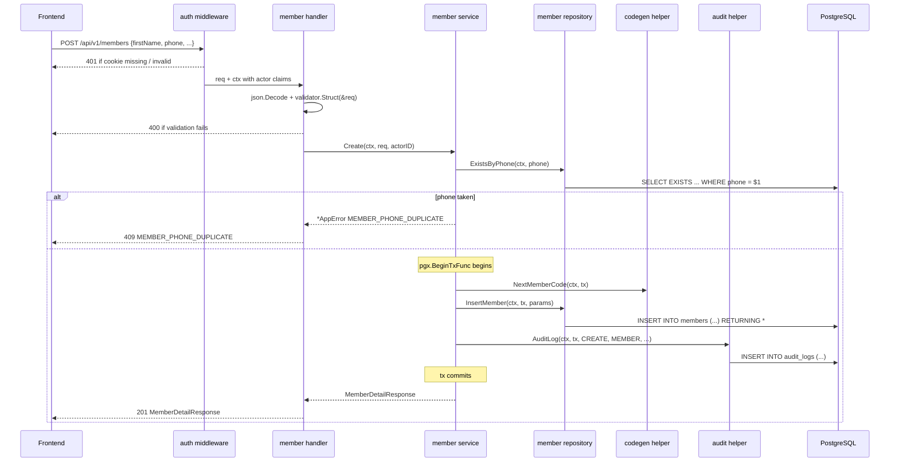
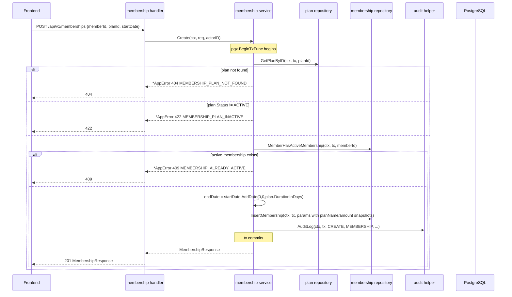
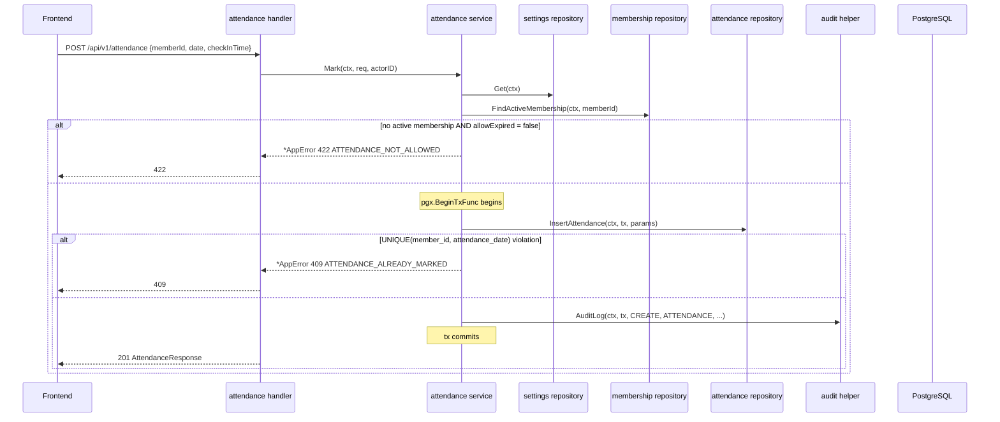
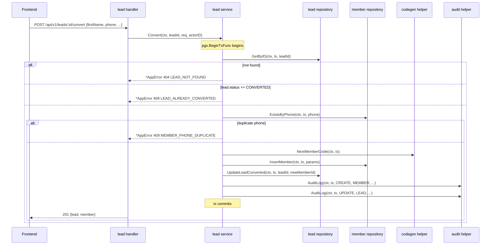
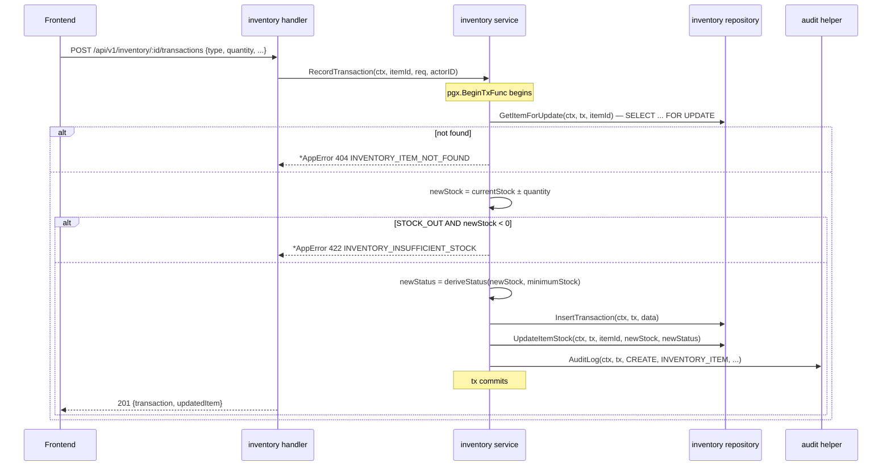

# 06 — Backend Low-Level Design (LLD)

## Technology

| Layer | Technology |
|---|---|
| Language | Go 1.23+ |
| HTTP router | chi (`go-chi/chi/v5`) |
| Persistence | pgx v5 (`jackc/pgx/v5`) + sqlc generated queries |
| Validation | `go-playground/validator/v10` |
| Auth | `golang-jwt/jwt/v5` JWT via httpOnly cookie + `gorilla/csrf` |
| Scheduler | `robfig/cron/v3` |
| Build | `go build -o gym-backend ./cmd/server` → single static binary |

---

## Package Structure

### Strategy: Package-by-Feature

The backend uses **package-by-feature** under `internal/modules/`.

**Why:** A package-by-layer layout (top-level `handlers/`, `services/`, `repositories/`) puts unrelated code together and related code apart. For a modular monolith, package-by-feature keeps all code for a single domain in one package — making each feature independently understandable. The Go `internal/` directory prevents external import, which enforces the module boundary at the compiler level.

```
backend/
│
├── cmd/
│   └── server/
│       └── main.go                   ← entry: Load config, build app, http.ListenAndServe
│
├── internal/
│   ├── app/
│   │   └── app.go                    ← builds chi.Router with all routes + middleware
│   │
│   ├── config/
│   │   └── config.go                 ← env-parsed Config struct (caarlos0/env)
│   │
│   ├── db/
│   │   ├── db.go                     ← pgxpool.New(ctx, DATABASE_URL)
│   │   ├── migrations/               ← goose SQL migrations
│   │   │   ├── 001_init.sql
│   │   │   ├── 002_seed_settings.sql
│   │   │   └── 003_code_sequences.sql
│   │   ├── queries/                  ← sqlc INPUT SQL
│   │   │   ├── users.sql
│   │   │   ├── members.sql
│   │   │   ├── memberships.sql
│   │   │   └── ... (one file per module)
│   │   └── sqlc/                     ← sqlc GENERATED Go (do not edit)
│   │       ├── models.go
│   │       ├── users.sql.go
│   │       ├── members.sql.go
│   │       └── ...
│   │
│   ├── middleware/
│   │   ├── auth.go                   ← RequireAuth; RequirePermission(perm) composer; ActorID helper
│   │   ├── logger.go                 ← slog request logger
│   │   ├── csrf.go                   ← gorilla/csrf wrapper
│   │   ├── cors.go                   ← CORS wrapper
│   │   └── errorhandler.go           ← recoverer + AppError → JSON
│   │
│   ├── common/                       ← shared infrastructure; no domain logic
│   │   ├── errors.go                 ← AppError, constructors, HTTPStatus accessor
│   │   ├── render/                   ← render.JSON, render.Error, render.ValidationError
│   │   ├── pagination.go             ← PageResponse[T], PageMeta, ParsePageQuery
│   │   ├── codegen.go                ← NextMemberCode(ctx, tx), NextUserCode, ...
│   │   ├── audit.go                  ← AuditLog(ctx, tx, entry), AuditEntry struct
│   │   ├── permissions.go            ← Role → []Permission map (mirrors frontend)
│   │   └── scheduler.go              ← cron.Cron wrapper + RunOverdueJobs helper
│   │
│   └── modules/
│       ├── auth/
│       │   ├── handler.go            ← /login, /logout, /me, /profile
│       │   ├── service.go            ← Login(ctx, email, password), ...
│       │   └── dto.go                ← LoginRequest, AuthUserResponse
│       │
│       ├── user/
│       │   ├── handler.go
│       │   ├── service.go
│       │   ├── repository.go         ← wraps sqlc.Queries
│       │   └── dto.go
│       │
│       ├── member/
│       │   ├── handler.go
│       │   ├── service.go
│       │   ├── repository.go
│       │   └── dto.go                ← CreateMemberRequest, UpdateMemberRequest,
│       │                                MemberListItemResponse, MemberDetailResponse
│       │
│       ├── membershipplan/
│       ├── membership/
│       ├── payment/
│       ├── attendance/
│       ├── trainer/
│       ├── assignment/               ← nested under /members/:id/trainer
│       ├── lead/
│       ├── expense/
│       ├── inventory/
│       ├── equipment/
│       ├── notification/
│       │   ├── handler.go
│       │   ├── service.go
│       │   ├── repository.go
│       │   ├── jobs.go               ← ExpireMemberships, SendExpiryNotifications
│       │   └── dto.go
│       ├── report/
│       │   ├── handler.go
│       │   ├── service.go
│       │   └── repository.go         ← read-only aggregation queries
│       ├── settings/
│       ├── auditlog/                 ← read-only
│       ├── search/
│       └── backup/
│           ├── handler.go
│           └── service.go            ← invokes pg_dump via os/exec
│
├── sqlc.yaml
├── go.mod
├── go.sum
├── .env.example
└── .gitignore
```

---

## Layer Responsibilities

### Handler (`handler.go`)

- Declares a `Routes() chi.Router` method that composes middleware (`RequireAuth`, `RequirePermission`) and routes.
- Decodes JSON into a request DTO.
- Runs struct-tag validation (`validator.Struct(&req)`).
- Reads actor ID from context (`middleware.ActorID(r.Context())`).
- Calls the service method.
- Encodes the response via `render.JSON(w, status, body)` or errors via `render.Error(w, err)`.
- **No business logic.**
- **No direct repository calls.**

### Service (`service.go`)

- Contains all business logic, domain rules, and workflow orchestration.
- Takes `context.Context` as the first argument and propagates it to pgx.
- Manages transactions with `pgx.BeginTxFunc`.
- Calls repository methods, maps sqlc row types to response DTOs.
- Calls `common.AuditLog(ctx, tx, entry)` inside the transaction.
- Returns typed `*common.AppError` for domain failures. Returns `nil` + response struct on success.

### Repository (`repository.go`)

- Owns a reference to `*sqlc.Queries` (constructed from the pool) and the `*pgxpool.Pool` for ad-hoc transactions.
- Exposes methods that are either direct sqlc call pass-throughs or hand-written `pool.Query(ctx, ...)` calls where sqlc isn't a good fit.
- **No business logic.**

### DTOs (`dto.go`)

- Request structs with `json:"..."` and `validate:"..."` struct tags.
- Response structs with `json:"..."` tags only.
- Never expose sqlc row types directly over the wire — map them to DTOs in the service layer.

---

## DTO Architecture

sqlc-generated row types are **never** returned directly from handlers. The flow is:

```
Incoming JSON
    ↓
json.Decoder → Request DTO       (struct tags: json, validate)
    ↓
validator.Struct(&req)           (returns ValidationErrors on failure)
    ↓
Handler                          (calls service with request DTO + ctx)
    ↓
Service                          (maps DTO → sqlc params, applies business rules)
    ↓
Repository → sqlc query          (parameterized SQL via pgx)
    ↓
PostgreSQL

PostgreSQL
    ↓
sqlc row type                    (returned by Queries.*)
    ↓
Service                          (maps row type → response DTO)
    ↓
Handler                          (render.JSON with response DTO)
    ↓
Response JSON
```

### DTO Naming Convention

| Type | Suffix | Example |
|---|---|---|
| Create input | `CreateXxxRequest` | `CreateMemberRequest` |
| Update input | `UpdateXxxRequest` | `UpdateMemberRequest` |
| List view output | `XxxListItemResponse` | `MemberListItemResponse` |
| Detail view output | `XxxDetailResponse` or `XxxResponse` | `MemberDetailResponse` |
| Nested sub-object | `XxxSummary` or `XxxInfo` | `MembershipSummary` |

### Mapping Strategy

Mapping is **manual** — a function per direction, written in the service file (or a `mapper.go` within the module if a feature has many mappings).

```go
func toMemberResponse(row sqlc.Member) MemberDetailResponse {
    return MemberDetailResponse{
        ID:         row.ID,
        MemberCode: row.MemberCode,
        FirstName:  row.FirstName,
        // ...
    }
}
```

Go does not have a compile-time mapper generator in common use that fits this scope. The number of fields per DTO is small; manual mapping is explicit, has no runtime cost, and keeps the type graph obvious. If a mapping gets large (>30 lines), split helpers inside the module.

---

## Validation

### Two Tiers of Validation

**Tier 1 — Request validation (struct tags on DTOs)**

Declared with `validate:` struct tags, enforced by `validator.Struct(&req)` in the handler:

```go
type CreateMemberRequest struct {
    FirstName   string `json:"firstName"             validate:"required,min=2,max=50"`
    LastName    string `json:"lastName,omitempty"    validate:"omitempty,max=50"`
    Phone       string `json:"phone"                 validate:"required,len=10,numeric"`
    Email       string `json:"email,omitempty"       validate:"omitempty,email"`
    DateOfBirth string `json:"dateOfBirth,omitempty" validate:"omitempty,datetime=2006-01-02"`
    Address     string `json:"address,omitempty"     validate:"omitempty,max=500"`
}
```

Common validator tags used across DTOs:

```
required         field must be set / non-zero
omitempty        skip validation if the field is empty
min=N / max=N    numeric or length bounds
len=N            exact length
email            email format (RFC 5322 subset)
numeric          digits only
datetime=LAYOUT  parse with time.Parse(LAYOUT, value)
gt=0 / gte=0     greater-than / greater-or-equal (for numbers)
oneof=A B C      enum-like whitelist
```

Validation errors produce `400 Bad Request` via `render.ValidationError(w, err)`, which collects `validator.ValidationErrors` into a field-level details object matching the frontend `ApiErrorData` shape.

**Tier 2 — Business validation (service layer)**

These rules cannot be expressed in struct tags because they depend on database state:

```
Member phone uniqueness            → SELECT, return *AppError (ConflictError)
One active membership per member   → query memberships table
Attendance duplicate check         → query attendance table
Inventory stock sufficiency check  → query current stock inside tx (FOR UPDATE)
Lead already converted             → check lead status
Inactive plan cannot be used       → check plan status
```

Service methods check these conditions and return domain errors before any mutation.

---

## Error Handling

### Domain Error Type

Go uses typed errors, not exceptions. A single `AppError` struct carries HTTP status, machine code, and message. Constructors produce the common shapes.

```go
// internal/common/errors.go
package common

type AppError struct {
    Code       string
    HTTPStatus int
    Message    string
    Details    any
}

func (e *AppError) Error() string { return e.Message }

func NewBadRequestError(code, msg string) *AppError {
    return &AppError{Code: code, HTTPStatus: 400, Message: msg}
}
func NewUnauthenticatedError() *AppError {
    return &AppError{Code: "UNAUTHENTICATED", HTTPStatus: 401, Message: "Authentication required."}
}
func NewForbiddenError() *AppError {
    return &AppError{Code: "FORBIDDEN", HTTPStatus: 403, Message: "You do not have permission."}
}
func NewNotFoundError(code, msg string) *AppError {
    return &AppError{Code: code, HTTPStatus: 404, Message: msg}
}
func NewConflictError(code, msg string) *AppError {
    return &AppError{Code: code, HTTPStatus: 409, Message: msg}
}
func NewBusinessRuleError(code, msg string) *AppError {
    return &AppError{Code: code, HTTPStatus: 422, Message: msg}
}
```

**Domain error construction examples** (in services):

```go
common.NewConflictError("MEMBER_PHONE_DUPLICATE",       "A member with this phone number already exists.")
common.NewConflictError("MEMBERSHIP_ALREADY_ACTIVE",    "This member already has an active membership.")
common.NewConflictError("ATTENDANCE_ALREADY_MARKED",    "Attendance has already been marked for this member on this date.")
common.NewBusinessRuleError("INVENTORY_INSUFFICIENT_STOCK", "Insufficient stock for this transaction.")
common.NewConflictError("LEAD_ALREADY_CONVERTED",       "This lead has already been converted.")
```

Returning typed errors — rather than defining a different type per domain — keeps the handler/middleware mapping trivial. The `Code` field discriminates the specific condition.

### Error Middleware (`render.Error`)

```go
// internal/common/render/render.go
func Error(w http.ResponseWriter, err error) {
    var ae *common.AppError
    if errors.As(err, &ae) {
        writeJSON(w, ae.HTTPStatus, apiError{
            Status:  ae.HTTPStatus,
            Code:    ae.Code,
            Message: ae.Message,
            Details: ae.Details,
        })
        return
    }
    // Unknown error: log and return 500 without leaking details.
    slog.ErrorContext(context.Background(), "unhandled error", "err", err)
    writeJSON(w, 500, apiError{Status: 500, Code: "INTERNAL_SERVER_ERROR", Message: "An unexpected error occurred."})
}
```

The chi `Recoverer` middleware catches panics; the generic 500 branch here handles non-`AppError` returned errors.

### Standard Error Response

```go
type apiError struct {
    Status  int    `json:"status"`
    Code    string `json:"code"`
    Message string `json:"message"`
    Details any    `json:"details,omitempty"`
}
```

Matches the frontend `ApiErrorData` interface.

---

## Transaction Management

The `pgx.BeginTxFunc` helper runs a function inside a transaction, committing on success and rolling back on any returned error (including panics).

Rules:
- Transactions live **in the service layer**, not in handlers or repositories.
- Every service method that mutates data across more than one statement is wrapped.
- The sqlc `Queries` is instantiated per transaction: `q := sqlc.New(tx)`.
- The audit log write is called inside the same transaction with `common.AuditLog(ctx, tx, entry)`.
- Read-only service methods do not need a transaction unless they issue multiple queries that must see a consistent snapshot.

```go
// Example — MembershipService.Create
func (s *Service) Create(ctx context.Context, req CreateMembershipRequest, actorID uuid.UUID) (*MembershipResponse, error) {
    var resp *MembershipResponse
    err := pgx.BeginTxFunc(ctx, s.pool, pgx.TxOptions{}, func(tx pgx.Tx) error {
        q := sqlc.New(tx)

        plan, err := q.GetPlanByID(ctx, req.PlanID)
        if err != nil {
            if errors.Is(err, pgx.ErrNoRows) {
                return common.NewNotFoundError("MEMBERSHIP_PLAN_NOT_FOUND", "Membership plan not found.")
            }
            return err
        }
        if plan.Status != "ACTIVE" {
            return common.NewBusinessRuleError("MEMBERSHIP_PLAN_INACTIVE", "Plan is not active.")
        }

        hasActive, err := q.MemberHasActiveMembership(ctx, req.MemberID)
        if err != nil {
            return err
        }
        if hasActive {
            return common.NewConflictError("MEMBERSHIP_ALREADY_ACTIVE", "This member already has an active membership.")
        }

        endDate := req.StartDate.AddDate(0, 0, int(plan.DurationInDays))
        row, err := q.InsertMembership(ctx, sqlc.InsertMembershipParams{
            MemberID:  req.MemberID,
            PlanID:    plan.ID,
            PlanName:  plan.Name,
            Amount:    plan.Price,
            StartDate: req.StartDate,
            EndDate:   endDate,
            Status:    "ACTIVE",
        })
        if err != nil {
            return err
        }

        if err := common.AuditLog(ctx, tx, common.AuditEntry{
            ActorID:    actorID,
            Action:     "CREATE",
            EntityType: "MEMBERSHIP",
            EntityID:   row.ID.String(),
        }); err != nil {
            return err
        }

        resp = toMembershipResponse(row)
        return nil
    })
    if err != nil {
        return nil, err
    }
    return resp, nil
}
```

### Operations requiring an explicit transaction

| Service method | Tables involved |
|---|---|
| `MembershipService.Create` | `memberships` INSERT + `audit_logs` INSERT |
| `PaymentService.Record` | `payments` INSERT + `audit_logs` INSERT |
| `AttendanceService.Mark` | `attendance` INSERT + `audit_logs` INSERT |
| `AssignmentService.Assign` | `assignments` UPDATE (end) + INSERT (new) + `audit_logs` INSERT |
| `LeadService.Convert` | `leads` UPDATE + `members` INSERT + `audit_logs` INSERT ×2 |
| `InventoryService.RecordTransaction` | `inventory_transactions` INSERT + `inventory_items` UPDATE + `audit_logs` INSERT |
| `MemberService.Create` | `members` INSERT + `audit_logs` INSERT |
| `UserService.Create` | `users` INSERT + `audit_logs` INSERT |
| `SettingsService.Save` | `gym_settings` UPDATE + `audit_logs` INSERT |

---

## Canonical Handler

```go
// internal/modules/member/handler.go
package member

import (
    "encoding/json"
    "net/http"

    "github.com/go-chi/chi/v5"
    "github.com/go-playground/validator/v10"

    "example.com/gym/internal/common"
    "example.com/gym/internal/common/render"
    "example.com/gym/internal/middleware"
)

type Handler struct {
    service   *Service
    validator *validator.Validate
}

func NewHandler(service *Service, v *validator.Validate) *Handler {
    return &Handler{service: service, validator: v}
}

func (h *Handler) Routes() chi.Router {
    r := chi.NewRouter()
    r.Use(middleware.RequireAuth)

    r.With(middleware.RequirePermission("members:view")).Get("/", h.list)
    r.With(middleware.RequirePermission("members:view")).Get("/{id}", h.get)
    r.With(middleware.RequirePermission("members:create")).Post("/", h.create)
    r.With(middleware.RequirePermission("members:edit")).Patch("/{id}", h.update)
    r.With(middleware.RequirePermission("members:delete")).Delete("/{id}", h.delete)

    return r
}

func (h *Handler) create(w http.ResponseWriter, r *http.Request) {
    var req CreateMemberRequest
    if err := json.NewDecoder(r.Body).Decode(&req); err != nil {
        render.Error(w, common.NewBadRequestError("INVALID_JSON", "Malformed JSON body"))
        return
    }
    if err := h.validator.Struct(&req); err != nil {
        render.ValidationError(w, err)
        return
    }

    actorID := middleware.ActorID(r.Context())
    member, err := h.service.Create(r.Context(), req, actorID)
    if err != nil {
        render.Error(w, err)
        return
    }
    render.JSON(w, http.StatusCreated, member)
}
```

---

## pgx + sqlc Design Notes

### Query Definition

Every module has an SQL file under `internal/db/queries/` with named queries using sqlc annotations:

```sql
-- internal/db/queries/members.sql

-- name: InsertMember :one
INSERT INTO members (id, member_code, first_name, last_name, phone, email, date_of_birth, address, status)
VALUES (gen_random_uuid(), $1, $2, $3, $4, $5, $6, $7, 'ACTIVE')
RETURNING *;

-- name: GetMemberByID :one
SELECT * FROM members WHERE id = $1;

-- name: ExistsMemberByPhone :one
SELECT EXISTS(SELECT 1 FROM members WHERE phone = $1) AS present;

-- name: ListMembersPaged :many
SELECT * FROM members
WHERE ($1::text = '' OR first_name ILIKE '%' || $1 || '%' OR phone ILIKE '%' || $1 || '%')
  AND ($2::text = '' OR status = $2)
ORDER BY created_at DESC
LIMIT $3 OFFSET $4;
```

sqlc reads these at generation time and produces type-safe Go functions. The repository layer calls them:

```go
func (r *Repository) ExistsByPhone(ctx context.Context, phone string) (bool, error) {
    return r.q.ExistsMemberByPhone(ctx, phone)
}
```

### Row Fetches and Null Handling

- Scalar nullable columns use pgx `pgtype.Text`, `pgtype.Date`, `pgtype.Timestamptz`, etc. in the generated structs.
- The service layer converts these to pointer types or empty strings when mapping to response DTOs.
- Enums stored as `TEXT` in Postgres (CHECK-constrained to the allowed set) are plain `string` fields in Go.

### Avoiding N+1

Where a list endpoint needs related data (member list with active trainer name), prefer:
- A hand-written join query defined in the `.sql` file, or
- A single aggregating query that produces a flat row shape the service maps to the response.

Do not loop over a result set and fire per-row queries. sqlc makes this discipline easy because every query is explicit.

### Enum Mapping

All enums are stored as `TEXT` with a `CHECK` constraint on the allowed values. In Go, they are plain `string` typedefs or `string` constants:

```go
type MemberStatus string

const (
    MemberStatusActive   MemberStatus = "ACTIVE"
    MemberStatusInactive MemberStatus = "INACTIVE"
)
```

Postgres native `ENUM` types are avoided because altering them requires migrations and `TEXT + CHECK` composes better with `goose`.

### Unique Constraints

Database-level unique constraints are the definitive guard. Service-layer existence checks exist for better error messages, but the DB constraint is the correctness boundary. The error middleware recognises Postgres `23505` (unique_violation) and `23503` (foreign_key_violation) by inspecting `*pgconn.PgError.Code` and `.ConstraintName`, mapping known constraints to domain error codes.

```go
var pgErr *pgconn.PgError
if errors.As(err, &pgErr) && pgErr.Code == "23505" {
    switch pgErr.ConstraintName {
    case "uq_member_phone":
        return common.NewConflictError("MEMBER_PHONE_DUPLICATE", "A member with this phone number already exists.")
    case "uq_attendance_member_date":
        return common.NewConflictError("ATTENDANCE_ALREADY_MARKED", "Attendance has already been marked.")
    }
}
```

### Audit Timestamps

Columns `created_at` (`TIMESTAMPTZ NOT NULL DEFAULT NOW()`) and `updated_at` (`TIMESTAMPTZ NOT NULL DEFAULT NOW()`). The `updated_at` column is maintained by a Postgres trigger (`BEFORE UPDATE` row-level trigger that sets `NEW.updated_at = NOW()`). This keeps timestamp management out of application code.

---

## Audit Helper

The audit helper lives in `internal/common/audit.go` and is called from any service inside the current transaction:

```go
package common

type AuditEntry struct {
    ActorID     uuid.UUID
    Action      string            // "CREATE", "UPDATE", "DELETE", "LOGIN", "LOGOUT"
    EntityType  string            // "MEMBER", "MEMBERSHIP", ...
    EntityID    string
    EntityName  string
    Description string
    Status      string            // "SUCCESS", "FAILED"
    Metadata    map[string]any    // optional; stored as JSONB
}

func AuditLog(ctx context.Context, tx pgx.Tx, entry AuditEntry) error {
    q := sqlc.New(tx)
    _, err := q.InsertAuditLog(ctx, sqlc.InsertAuditLogParams{ ... })
    return err
}
```

Because the helper takes a `pgx.Tx`, the audit insert is always part of the same transaction as the primary operation. If the primary operation returns an error, `BeginTxFunc` rolls back the whole thing.

For failed-login audit records, the audit insert is called outside a transaction (`AuditLogWithPool(ctx, pool, entry)`) since there is no primary mutation to join.

---

## Code Generator

```go
// internal/common/codegen.go
package common

func NextMemberCode(ctx context.Context, tx pgx.Tx) (string, error) {
    return nextCode(ctx, tx, "MEM-", "member_code_seq")
}
func NextUserCode(ctx context.Context, tx pgx.Tx) (string, error) {
    return nextCode(ctx, tx, "USR-", "user_code_seq")
}
func NextTrainerCode(ctx context.Context, tx pgx.Tx) (string, error) {
    return nextCode(ctx, tx, "TRN-", "trainer_code_seq")
}
func NextLeadCode(ctx context.Context, tx pgx.Tx) (string, error) {
    return nextCode(ctx, tx, "LEAD-", "lead_code_seq")
}
// ...NextExpenseCode, NextItemCode, NextEquipCode

func nextCode(ctx context.Context, tx pgx.Tx, prefix, sequence string) (string, error) {
    var n int64
    row := tx.QueryRow(ctx, "SELECT nextval($1)", sequence)
    if err := row.Scan(&n); err != nil {
        return "", err
    }
    return fmt.Sprintf("%s%03d", prefix, n), nil
}
```

Sequences (`member_code_seq`, `user_code_seq`, …) are created in migration `003_code_sequences.sql`. Postgres sequences are inherently concurrent-safe, so two simultaneous `nextval` calls always return distinct values.

---

## Scheduled Jobs

```go
// internal/common/scheduler.go
package common

func NewScheduler(loc *time.Location) *cron.Cron {
    return cron.New(cron.WithLocation(loc))
}

// internal/app/app.go — during startup
loc, _ := time.LoadLocation("Asia/Kolkata")
c := common.NewScheduler(loc)

c.AddFunc("0 0 * * *", wrapJob(pool, "expire_memberships",         notification.ExpireMemberships))
c.AddFunc("0 9 * * *", wrapJob(pool, "send_expiry_notifications",  notification.SendExpiryNotifications))
c.AddFunc("0 2 * * *", wrapJob(pool, "daily_backup",               backup.RunBackup))

c.Start()
```

`wrapJob` is a small helper that opens its own `context.Context` (with a deadline), logs start/end at INFO, and recovers from panics so a single bad run never kills the cron instance.

No external job queue is used. The cron goroutine runs inside the same process as the HTTP server.

---

## Sequence Diagrams

### Create Member



---

### Create Membership



---

### Mark Attendance



---

### Convert Lead to Member



---

### Inventory Stock Transaction



---

## Testing Strategy

### Unit Tests — business logic in isolation

Use the standard `testing` package with `testify/require`. Repositories are hidden behind small interfaces defined at the service's consumer so they can be faked:

```go
// In the service package
type memberRepo interface {
    ExistsByPhone(ctx context.Context, phone string) (bool, error)
    Insert(ctx context.Context, tx pgx.Tx, p sqlc.InsertMemberParams) (sqlc.Member, error)
}

// In the test
type fakeRepo struct { phoneTaken bool }
func (f *fakeRepo) ExistsByPhone(ctx context.Context, phone string) (bool, error) { return f.phoneTaken, nil }
func (f *fakeRepo) Insert(ctx context.Context, tx pgx.Tx, p sqlc.InsertMemberParams) (sqlc.Member, error) { return sqlc.Member{}, nil }

func TestCreateMember_DuplicatePhone(t *testing.T) {
    s := NewService(&fakeRepo{phoneTaken: true}, nil, nil)
    _, err := s.Create(context.Background(), CreateMemberRequest{Phone: "9876543210"}, uuid.New())

    var ae *common.AppError
    require.ErrorAs(t, err, &ae)
    require.Equal(t, "MEMBER_PHONE_DUPLICATE", ae.Code)
    require.Equal(t, 409, ae.HTTPStatus)
}
```

**What to unit test:**
- Business rules in services.
- Derived computations (`endDate = startDate.AddDate(0,0,plan.DurationInDays)`).
- Error conditions (duplicate phone, already-active membership, etc.).
- Permission map lookups.

### Handler Tests — request validation, auth, response shape

Use `net/http/httptest` to exercise the chi router with a stub service:

```go
func TestCreateMember_InvalidPhone_Returns400(t *testing.T) {
    h := NewHandler(&stubService{}, validator.New())
    r := chi.NewRouter()
    r.Mount("/api/v1/members", h.Routes())

    body := `{"firstName":"Rahul","phone":"123"}`
    req := httptest.NewRequest(http.MethodPost, "/api/v1/members", strings.NewReader(body))
    req.Header.Set("Content-Type", "application/json")
    rr := httptest.NewRecorder()

    r.ServeHTTP(rr, withTestAuth(req))

    require.Equal(t, http.StatusBadRequest, rr.Code)
    require.Contains(t, rr.Body.String(), "VALIDATION_ERROR")
}
```

Separate tests cover:
- Unauthenticated (no cookie) → 401.
- Receptionist calling `DELETE /members/:id` → 403.
- Owner calling `POST /members` → 201.
- Response JSON matches the expected DTO.

### Integration Tests — full stack against real PostgreSQL

Use `testcontainers-go/modules/postgres` to spin up a real PostgreSQL per test package. Run `goose up` on the container, then exercise the whole stack through the chi router.

```go
func TestCreateMembership_FullFlow(t *testing.T) {
    pg := postgres.MustRun(t)                   // starts a container, returns conn string
    pool := db.MustPool(t, pg.ConnString())
    db.MustMigrate(t, pg.ConnString())          // goose up

    app := buildTestApp(pool)
    rr := app.POST(t, "/api/v1/members", createMemberBody())
    require.Equal(t, 201, rr.Code)

    // ... create plan ...
    // ... create membership ...
}
```

Integration tests exercise handler → service → repository → PostgreSQL. They validate:
- Unique constraints fire (`UNIQUE(phone)`, partial unique index for one-active-membership).
- Foreign keys block deletes (`members` referenced by `memberships`).
- Enum CHECK constraints reject unknown values.
- `pg_dump` import/export round-trips cleanly (used in backup tests).

### Test Database Strategy

- Unit tests: pure Go, no DB.
- Handler tests: `httptest` + stub service.
- Integration tests: `testcontainers-go/modules/postgres` with real PostgreSQL.

testcontainers was chosen rather than SQLite / H2 equivalents because this system relies on Postgres-specific features (partial unique indexes, `ILIKE`, `TIMESTAMPTZ`, sequences). Testing against anything else would miss constraint behaviour.

Each integration test wraps its work in a transaction that is rolled back on test end, so tests do not pollute shared state within the same container.
