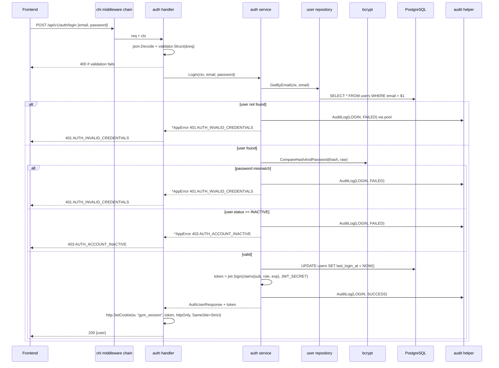

# 07 — Authentication & Security

## Overview

Authentication and authorization are implemented as **chi middleware** composed around the HTTP router. The stack is:

- `gorilla/csrf` middleware for CSRF protection on state-changing requests.
- `RequireAuth` middleware that reads a JWT from an httpOnly cookie, verifies it, and attaches the user claims to the request context.
- `RequirePermission(perm)` middleware composed on route groups to enforce authorization.
- `golang.org/x/crypto/bcrypt` for password hashing (cost 12).

There is no auth framework. The composition is a few hundred lines of explicit code against `net/http` stdlib primitives and `golang-jwt/jwt/v5`.

---

## Authentication

### Transport: JWT in httpOnly cookie

A short-lived signed JWT is set as an httpOnly, SameSite=Strict, Secure cookie on login. The browser automatically includes it with every same-origin request to the Go backend. On each request, `RequireAuth` middleware verifies the JWT signature and expiry, parses the claims (user ID, role), and places them on the request context. Logout clears the cookie.

**Why this combination:**
- httpOnly cookie: not reachable from JavaScript, so XSS cannot steal the token.
- SameSite=Strict: eliminates cross-site CSRF for the cookie itself.
- Signed JWT: no server-side session store needed; validation is stateless.
- Behaves like a session from the frontend's perspective (no `Authorization` header management, no refresh tokens for a LAN system).

For a LAN system that is same-origin end-to-end (frontend and backend on the same host and port), this gives session-like UX with a stateless backend. If the frontend is ever served from a different origin, CORS with `credentials: include` is required.

**CSRF:** `gorilla/csrf` middleware is applied to the router. It issues a double-submit cookie + header pair for state-changing methods. The React client reads the CSRF token from a cookie and echoes it in the `X-CSRF-Token` header. Safe methods (GET, HEAD, OPTIONS) are not challenged.

---

### Login Flow



### Logout

- `POST /api/v1/auth/logout`
- The handler writes an expired `gym_session` cookie (MaxAge=-1) to clear it from the browser.
- No server-side state to invalidate; the token's remaining validity is accepted as a known limitation (same tradeoff as any stateless JWT scheme).
- Audit log written on logout.

### Current User

- `GET /api/v1/auth/me`
- The handler reads the user ID from `middleware.ActorID(r.Context())`, fetches the user, and returns the profile DTO (never `passwordHash`).

---

## Middleware Composition

### Router Assembly

```go
// internal/app/app.go
func New(cfg *config.Config, pool *pgxpool.Pool) *http.Server {
    r := chi.NewRouter()

    r.Use(mw.Recoverer)                            // chi stdlib
    r.Use(middleware.SlogRequestLogger)            // internal/middleware/logger.go
    r.Use(middleware.CORS(cfg.FrontendOrigin))
    r.Use(middleware.CSRF(cfg.CookieSecret))

    r.Route("/api/v1", func(r chi.Router) {
        r.Mount("/auth",            authHandler.Routes())
        r.Mount("/users",           userHandler.Routes())
        r.Mount("/members",         memberHandler.Routes())
        r.Mount("/memberships",     membershipHandler.Routes())
        r.Mount("/membership-plans", membershipPlanHandler.Routes())
        r.Mount("/payments",        paymentHandler.Routes())
        r.Mount("/attendance",      attendanceHandler.Routes())
        r.Mount("/trainers",        trainerHandler.Routes())
        r.Mount("/leads",           leadHandler.Routes())
        r.Mount("/expenses",        expenseHandler.Routes())
        r.Mount("/inventory",       inventoryHandler.Routes())
        r.Mount("/equipment",       equipmentHandler.Routes())
        r.Mount("/notifications",   notificationHandler.Routes())
        r.Mount("/reports",         reportHandler.Routes())
        r.Mount("/settings",        settingsHandler.Routes())
        r.Mount("/audit-logs",      auditLogHandler.Routes())
        r.Mount("/search",          searchHandler.Routes())
        r.Mount("/backup",          backupHandler.Routes())
    })

    r.Get("/health", healthHandler)                // public

    return &http.Server{Addr: fmt.Sprintf(":%d", cfg.Port), Handler: r}
}
```

The `/health` route is deliberately mounted outside `/api/v1` and without `RequireAuth` so health probes work without credentials.

### `RequireAuth`

```go
// internal/middleware/auth.go
func RequireAuth(next http.Handler) http.Handler {
    return http.HandlerFunc(func(w http.ResponseWriter, r *http.Request) {
        cookie, err := r.Cookie("gym_session")
        if err != nil {
            render.Error(w, common.NewUnauthenticatedError())
            return
        }
        claims, err := jwtutil.Verify(cookie.Value)
        if err != nil {
            render.Error(w, common.NewUnauthenticatedError())
            return
        }
        ctx := context.WithValue(r.Context(), ctxKeyUser, claims)
        next.ServeHTTP(w, r.WithContext(ctx))
    })
}

func ActorID(ctx context.Context) uuid.UUID {
    c, _ := ctx.Value(ctxKeyUser).(*Claims)
    return c.UserID
}

func UserFromContext(ctx context.Context) *Claims {
    c, _ := ctx.Value(ctxKeyUser).(*Claims)
    return c
}
```

The claims struct contains the minimum needed for authorization — user ID and role string:

```go
type Claims struct {
    UserID uuid.UUID `json:"sub"`
    Role   string    `json:"role"`
    jwt.RegisteredClaims
}
```

### `RequirePermission`

```go
func RequirePermission(perm string) func(http.Handler) http.Handler {
    return func(next http.Handler) http.Handler {
        return http.HandlerFunc(func(w http.ResponseWriter, r *http.Request) {
            user := UserFromContext(r.Context())
            if !permissions.Has(user.Role, perm) {
                render.Error(w, common.NewForbiddenError())
                return
            }
            next.ServeHTTP(w, r)
        })
    }
}
```

Composed on route groups inside each module's `Routes()`:

```go
r.With(middleware.RequireAuth, middleware.RequirePermission("members:create")).
    Post("/", h.create)
```

### Password Hashing

```go
hash, err := bcrypt.GenerateFromPassword([]byte(rawPassword), 12)
// store hash in users.password_hash

err := bcrypt.CompareHashAndPassword(storedHash, []byte(rawPassword))
if errors.Is(err, bcrypt.ErrMismatchedHashAndPassword) { /* mismatch */ }
```

- Cost factor 12 (configurable but not exposed; constant).
- The raw password never appears in logs, responses, or audit records.
- Mock plain-text passwords in `auth.mock.ts` must never reach production.

---

## Authorization

### Role-Based Permission Model

The frontend defines four roles (`OWNER`, `ADMIN`, `RECEPTIONIST`, `TRAINER`) and 40+ specific permissions (e.g., `members:create`, `payments:record`). The backend mirrors this model.

**Implementation:**

`internal/common/permissions.go` is a static map from role string to permission set. It is the authoritative definition on the backend side and must be kept in sync with `frontend/src/features/auth/permissions/permissions.ts`.

```go
// internal/common/permissions.go
package permissions

var rolePermissions = map[string]map[string]struct{}{
    "OWNER":        toSet("dashboard:view", "members:view", "members:create", /* ...all... */),
    "ADMIN":        toSet(/* ... */),
    "RECEPTIONIST": toSet(/* ... */),
    "TRAINER":      toSet(/* ... */),
}

func Has(role, permission string) bool {
    perms, ok := rolePermissions[role]
    if !ok {
        return false
    }
    _, has := perms[permission]
    return has
}

func toSet(items ...string) map[string]struct{} {
    m := make(map[string]struct{}, len(items))
    for _, s := range items { m[s] = struct{}{} }
    return m
}
```

The permission string vocabulary matches the frontend verbatim; any drift causes real authorization bugs. A `TestFrontendBackendPermissionParity` test loads the frontend permissions JSON (committed snapshot) and asserts the Go map matches.

### Route-Level Authorization

```go
// internal/modules/member/handler.go
func (h *Handler) Routes() chi.Router {
    r := chi.NewRouter()
    r.Use(middleware.RequireAuth)

    r.With(middleware.RequirePermission("members:view")).Get("/", h.list)
    r.With(middleware.RequirePermission("members:view")).Get("/{id}", h.get)
    r.With(middleware.RequirePermission("members:create")).Post("/", h.create)
    r.With(middleware.RequirePermission("members:edit")).Patch("/{id}", h.update)
    r.With(middleware.RequirePermission("members:delete")).Delete("/{id}", h.delete)

    return r
}
```

Each route composes `RequireAuth` once at the top of the router and `RequirePermission(perm)` per route. The chain is: `Recoverer → logger → CORS → CSRF → RequireAuth → RequirePermission → handler`.

### Authorization Principle

```
Frontend permission check → UX (hides buttons, blocks navigation)
Backend RequirePermission → actual security boundary
```

The backend does not trust that the frontend has correctly enforced permissions. Every protected endpoint verifies authorization server-side before any database operation.

---

## Full Permission Matrix

```
Permission                   OWNER   ADMIN   RECEPTIONIST   TRAINER
─────────────────────────────────────────────────────────────────────
dashboard:view                 ✓       ✓           ✓           ✓
members:view                   ✓       ✓           ✓           ✓
members:create                 ✓       ✓           ✓
members:edit                   ✓       ✓           ✓
members:delete                 ✓       ✓
memberships:view               ✓       ✓           ✓           ✓
memberships:create             ✓       ✓           ✓
membership-plans:view          ✓       ✓           ✓
membership-plans:create        ✓       ✓
membership-plans:edit          ✓       ✓
membership-plans:delete        ✓       ✓
attendance:view                ✓       ✓           ✓           ✓
attendance:mark                ✓       ✓           ✓           ✓
payments:view                  ✓       ✓           ✓
payments:record                ✓       ✓           ✓
trainers:view                  ✓       ✓           ✓           ✓
trainers:create                ✓       ✓
trainers:edit                  ✓       ✓
trainers:delete                ✓       ✓
leads:view                     ✓       ✓           ✓
leads:create                   ✓       ✓           ✓
leads:edit                     ✓       ✓           ✓
leads:delete                   ✓       ✓
expenses:view                  ✓       ✓
expenses:create                ✓       ✓
expenses:edit                  ✓       ✓
expenses:delete                ✓       ✓
inventory:view                 ✓       ✓           ✓
inventory:create               ✓       ✓
inventory:edit                 ✓       ✓
inventory:delete               ✓       ✓
equipment:view                 ✓       ✓
equipment:create               ✓       ✓
equipment:edit                 ✓       ✓
equipment:delete               ✓       ✓
equipment:maintenance          ✓       ✓
reports:view                   ✓       ✓
users:view                     ✓       ✓
users:create                   ✓       ✓
users:edit                     ✓       ✓
users:delete                   ✓
settings:view                  ✓       ✓
settings:edit                  ✓
notifications:view             ✓       ✓           ✓           ✓
notifications:create           ✓       ✓           ✓
audit-logs:view                ✓       ✓
profile:view                   ✓       ✓           ✓           ✓
profile:update                 ✓       ✓           ✓           ✓
```

---

## Security Controls

### Input Validation

Request DTOs carry `validate:"..."` struct tags (`required`, `email`, `len=10,numeric`, `datetime=2006-01-02`, …). `validator.Struct(&req)` runs in the handler. Invalid requests return `400 Bad Request` before reaching the service.

See `08-cross-cutting-concerns.md` and `06-backend-lld.md` for the full validation story.

### SQL Injection Protection

pgx uses parameterized queries exclusively (`$1`, `$2`, …). sqlc enforces this at generation time — all generated functions use parameter placeholders. No string concatenation of user input into SQL is permitted. Hand-written queries in the repository layer must use `$N` placeholders.

### Rate Limiting

Apply rate limiting on `POST /api/v1/auth/login` to prevent brute-force. The chosen implementation is the `github.com/ulule/limiter/v3` package wired as chi middleware — token bucket, in-memory store, scoped to source IP, configured for 5 attempts per minute. In-memory is sufficient because this is a single-process LAN system.

```go
rate, _ := limiter.NewRateFromFormatted("5-M")
store := memory.NewStore()
loginLimiter := stdlib.NewMiddleware(limiter.New(store, rate))

r.With(loginLimiter).Post("/login", h.login)
```

### CORS

CORS is wired via a small wrapper in `internal/middleware/cors.go` (built on `github.com/go-chi/cors`). It allows only the configured frontend origin, allows credentials (required for cookie auth), and allows the standard methods plus `OPTIONS` for preflight:

```go
return cors.Handler(cors.Options{
    AllowedOrigins:   []string{cfg.FrontendOrigin},
    AllowedMethods:   []string{"GET", "POST", "PATCH", "PUT", "DELETE", "OPTIONS"},
    AllowedHeaders:   []string{"Content-Type", "X-CSRF-Token"},
    AllowCredentials: true,
    MaxAge:           300,
})
```

### CSRF

`gorilla/csrf` is applied at the router level with the cookie secret from config:

```go
csrfMW := csrf.Protect(
    []byte(cfg.CookieSecret),
    csrf.Secure(cfg.Env == "prod"),
    csrf.SameSite(csrf.SameSiteStrictMode),
    csrf.Path("/"),
)
```

The frontend reads the CSRF token from the `_gorilla_csrf` cookie and echoes it in the `X-CSRF-Token` header. Safe methods are not challenged.

### Secrets Management

All secrets (`JWT_SECRET`, `COOKIE_SECRET`, `DATABASE_URL` with password) are provided via environment variables and parsed into `*config.Config` on startup by `caarlos0/env`. No secrets in source code or committed config files. In production, the systemd unit's `EnvironmentFile=` points at a mode-600 `.env` file; on Windows, NSSM injects the env.

### Sensitive Data in Responses

- The `password_hash` column on the `users` table must **never** appear in any API response DTO. The `UserResponse` struct does not have a password-hash field; mapping is explicit.
- `MemberResponse` and `MemberListItemResponse` do not expose sensitive fields (emergency contact details, address) in list endpoints — only in the detail endpoint.

### HTTPS

**OPEN DECISION:** Whether to configure HTTPS on LAN (self-signed certificate or local CA). Even on LAN, HTTPS prevents credential interception. In Go this is a one-liner: `http.ListenAndServeTLS(":8443", certFile, keyFile, handler)`.

### Audit Log Write Protection

The application's database user does not have `DELETE` privilege on the `audit_logs` table. This is an additional defense layer (application-level logic already forbids deletes, but DB-level enforcement is stronger). Grant is tightened in a post-migration SQL script executed by the operator, not by the application.

---

## Authentication Integration Contract (for Frontend)

The `AuthTransport` interface in `src/lib/api/auth.ts` must be implemented to call the real backend. The interface methods map to:

| Method | Backend endpoint |
|---|---|
| `login(email, password)` | `POST /api/v1/auth/login` — sets `gym_session` cookie, returns `{ user }` |
| `logout()` | `POST /api/v1/auth/logout` — clears cookie |
| `getCurrentUserId()` | `GET /api/v1/auth/me` — returns `{ user }` or 401 |
| `refreshSession()` | Not applicable — cookie TTL governs session; stale cookie yields 401 |

The `apiClient` in `src/lib/api/client.ts` must:
- Send credentials: `fetch(url, { credentials: 'include', ... })` so the httpOnly cookie travels with every API call.
- Read the CSRF token from the `_gorilla_csrf` cookie and set `X-CSRF-Token` on state-changing requests.
- Intercept `401` responses to trigger logout/redirect.
