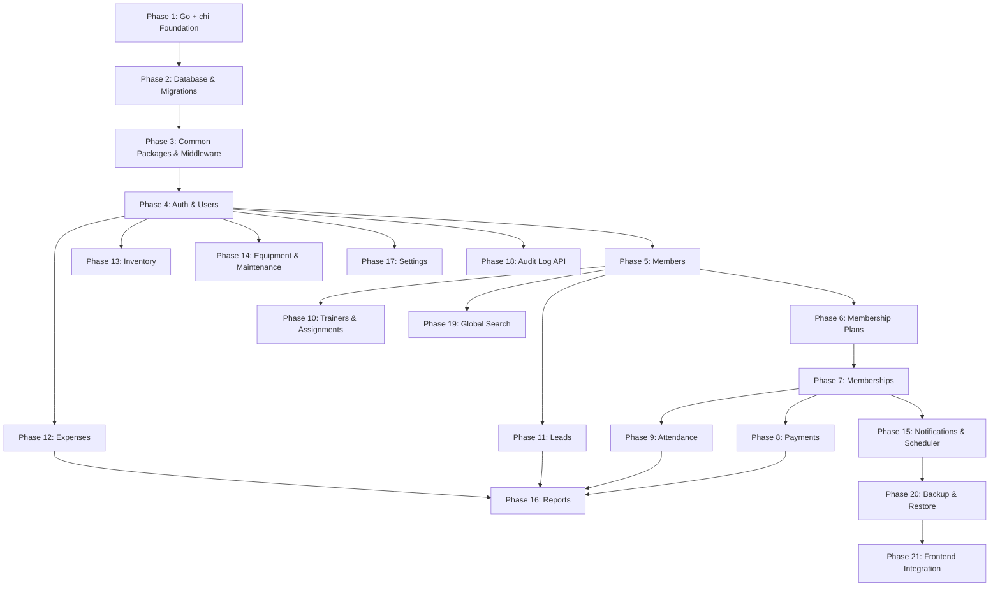

# 10 — Backend Development Plan

## Technology Baseline

```
Language:           Go 1.23+
HTTP router:        chi (go-chi/chi/v5)
Architecture:       Modular Monolith (single binary)
API:                REST
DB driver:          pgx v5 (jackc/pgx/v5) + pgxpool
SQL layer:          sqlc (sqlc-dev/sqlc) — type-safe generated query functions
Database:           PostgreSQL 15+
Migration tool:     goose (pressly/goose) — CLI-triggered
Auth:               golang-jwt/jwt/v5 in httpOnly SameSite=Strict cookie + gorilla/csrf
Password hashing:   golang.org/x/crypto/bcrypt (cost 12)
Validation:         go-playground/validator/v10 (struct tags)
Scheduler:          robfig/cron/v3
Logging:            log/slog (stdlib) — JSON in prod
Config:             caarlos0/env/v11
Rate limiting:      go-chi/httprate (login brute-force protection)
API documentation:  swaggo/swag (OPEN DECISION — may skip for v1)
Testing:            stdlib testing + stretchr/testify + net/http/httptest + testcontainers-go/postgres
Build:              go build -o gym-backend ./cmd/server (single static binary)
```

---

## Implementation Dependency Graph



---

## Phase 1 — Go + chi Foundation

**Objective:** Bootstrapped, runnable Go project with no domain code yet.

**Work:**
- `go mod init github.com/<org>/gym-backend`
- Add dependencies: `go-chi/chi/v5`, `jackc/pgx/v5`, `jackc/pgx/v5/pgxpool`, `caarlos0/env/v11`, `go-playground/validator/v10`
- Create directory structure (see `09-deployment-operations.md`): `cmd/server/`, `internal/{app,config,db,middleware,common,modules}/`
- `internal/config/config.go` — Config struct + `Load()` using `caarlos0/env`
- `cmd/server/main.go` — load config, build logger, build app, `http.ListenAndServe`
- `internal/app/app.go` — build chi router with chi stdlib middleware (`Recoverer`, `RealIP`)
- `internal/middleware/logger.go` — slog request logger middleware
- Public `GET /health` route (no DB yet — returns `{status: "ok"}`)
- `.env.example` committed; `.env` in `.gitignore`
- `Makefile` with `dev`, `build`, `test` targets

**Completion criteria:**
- `go run ./cmd/server` starts without errors.
- `GET http://localhost:8080/health` returns `200 { "status": "ok" }`.
- `go build -o gym-backend ./cmd/server` produces a working binary.
- Request logs appear in stdout as JSON lines.

---

## Phase 2 — Database & Migrations

**Objective:** All database tables, enums, constraints, and indexes created via `goose` migrations. `sqlc` configured and generating.

**Dependencies:** Phase 1

**Work:**
- Add dependencies: `pressly/goose/v3` (runtime), install `goose` CLI
- Install `sqlc` CLI (`go install github.com/sqlc-dev/sqlc/cmd/sqlc@latest`)
- `sqlc.yaml` — point at `internal/db/migrations/` for schema and `internal/db/queries/` for queries
- `internal/db/db.go` — `pgxpool.New(ctx, cfg.DatabaseURL)` singleton
- Write migration files in dependency order:
  1. `001_create_enum_types.sql` — all PostgreSQL enum types
  2. `002_create_users.sql`
  3. `003_create_gym_settings.sql` + seed row (`gym_settings.id = 1`)
  4. `004_create_members.sql`
  5. `005_create_membership_plans.sql`
  6. `006_create_memberships.sql` + partial unique index on active membership
  7. `007_create_payments.sql`
  8. `008_create_attendance.sql` + `UNIQUE(member_id, attendance_date)`
  9. `009_create_trainers.sql`
  10. `010_create_member_trainer_assignments.sql` + partial unique index
  11. `011_create_leads.sql`
  12. `012_create_expense_categories.sql`
  13. `013_create_expenses.sql`
  14. `014_create_inventory_categories.sql`
  15. `015_create_inventory_items.sql`
  16. `016_create_inventory_transactions.sql`
  17. `017_create_equipment_categories.sql`
  18. `018_create_equipment.sql`
  19. `019_create_equipment_maintenance.sql`
  20. `020_create_notification_records.sql` + partial unique index for daily dedupe
  21. `021_create_audit_logs.sql`
  22. `022_create_code_sequences.sql` — all `_code_seq` Postgres sequences
  23. `023_create_scheduled_job_runs.sql` — tracking table for Intermittent Availability

**Completion criteria:**
- `goose -dir internal/db/migrations postgres "$DATABASE_URL" up` applies all migrations cleanly.
- All tables exist with correct columns, types, constraints.
- Partial unique indexes exist and can be verified via `\d+ memberships`.
- `sqlc generate` produces compilable Go in `internal/db/sqlc/`.
- `main.go` opens the pool at startup and `/health` reports DB status via `pool.Ping(ctx)`.

---

## Phase 3 — Common Packages & Middleware

**Objective:** Shared infrastructure that every feature module depends on.

**Dependencies:** Phase 2

**Work:**
- **`internal/common/errors.go`:**
  - `AppError` struct with `Code`, `HTTPStatus`, `Message`, `Details`.
  - Constructors: `NewNotFoundError`, `NewConflictError`, `NewBusinessRuleError`, `NewForbiddenError`, `NewUnauthenticatedError`, `NewBadRequestError`, `NewInternalError`.
- **`internal/middleware/errorhandler.go`:**
  - Middleware that recovers panics and renders them as 500.
  - `render` package: `JSON`, `Error`, `ValidationError` helpers; `Error` uses `errors.As(err, &AppError{})` to pick a status.
- **`internal/common/pagination.go`:**
  - Generic `PageResponse[T]` + `PageMeta`.
  - `ParsePageQuery(r)` helper returning `(page, pageSize)` with clamping (1–100).
- **`internal/common/codegen.go`:**
  - `NextMemberCode(ctx, tx) (string, error)` etc. — queries Postgres sequences and formats as `MEM-001`.
- **`internal/common/audit.go`:**
  - `AuditEntry` struct + `AuditLog(ctx, tx, entry) error` helper.
  - Called inside `pgx.BeginTxFunc` so the write participates in the primary transaction.
- **`internal/common/permissions.go`:**
  - Role + Permission string types, role→permission map, `Has(role, perm) bool`.
  - Mirrors `frontend/src/features/auth/permissions/permissions.ts` verbatim.
- **`internal/common/scheduler.go`:**
  - Wraps `robfig/cron/v3`.
  - `RegisterJob(name, cronExpr, handler)` + `RunOverdueJobs(ctx, pool)` + `WithJobRun(tx, name, handler)` wrapper.
- **`internal/middleware/auth.go`:**
  - `RequireAuth` — JWT verify from cookie, place claims on context (stub real JWT verify until Phase 4).
  - `RequirePermission(perm)` — context lookup + `permissions.Has`.
  - `ActorID(ctx)`, `UserFromContext(ctx)` helpers.

**Tests:**
- `errorhandler` maps `AppError` → correct JSON with correct status.
- `errorhandler` maps `validator.ValidationErrors` → 400 with field details.
- `codegen` increments and formats correctly.
- `permissions.Has` returns correct result for each role × permission combination (table-driven test).

**Completion criteria:**
- All common packages compile and unit tests pass.
- `ApiError` JSON shape matches the frontend `ApiErrorData` interface in `src/lib/api/errors.ts`.

---

## Phase 4 — Authentication & Users

**Objective:** Working login/logout, cookie-JWT session, user CRUD. Blocker for all later feature phases.

**Dependencies:** Phase 3

**Entities:** `users` table (already migrated in Phase 2)

**Dependencies to add:** `golang-jwt/jwt/v5`, `golang.org/x/crypto/bcrypt`, `gorilla/csrf`, `go-chi/httprate`, `go-chi/cors`

**APIs implemented:**
- `POST /api/v1/auth/login`
- `POST /api/v1/auth/logout`
- `GET /api/v1/auth/me`
- `GET /api/v1/csrf-token`
- `PATCH /api/v1/auth/profile`
- `GET /api/v1/users` (paginated, filter by role/status)
- `GET /api/v1/users/:id`
- `POST /api/v1/users`
- `PATCH /api/v1/users/:id`
- `DELETE /api/v1/users/:id`

**Business logic:**
- `bcrypt.GenerateFromPassword(raw, 12)` on create / password change.
- JWT signing (HS256) with `cfg.JWTSecret`; claims: `sub` (user UUID), `role`, `exp` (now + `SessionTTL`).
- `http.SetCookie` with `HttpOnly=true, SameSite=SameSiteStrictMode, Secure=cfg.HTTPSEnabled, MaxAge=cfg.SessionTTL`.
- Rate limit `POST /login` to 5/minute per IP via `httprate.LimitByIP`.
- CSRF middleware mounted on `/api/v1/*` (safe methods exempt).
- `UPDATE users SET last_login_at = NOW()` on successful login.
- INACTIVE user login rejected with `403 AUTH_ACCOUNT_INACTIVE`.
- User code generation (`USR-001`, `USR-002`, …).
- Audit log for LOGIN SUCCESS, LOGIN FAILED, LOGOUT, user CREATE/UPDATE/DELETE.

**DTOs:**
- `LoginRequest { Email, Password string }` with `validate:"required,email"` and `validate:"required,min=8"`
- `AuthUserResponse` (no `PasswordHash` field)
- `CreateUserRequest`, `UpdateUserRequest`, `UserResponse`

**Tests:**
- Login with valid credentials → 200 + `Set-Cookie: gym_session=...`.
- Login with wrong password → 401.
- Login with INACTIVE user → 403.
- Protected endpoint without cookie → 401.
- Protected endpoint with expired cookie → 401.
- RECEPTIONIST cannot `POST /users` → 403.
- OWNER can `DELETE /users/:id`; ADMIN cannot → 403.
- Create user with duplicate email → 409.
- Rate limit on 6th login attempt in a minute → 429.
- CSRF-protected POST without `X-CSRF-Token` → 403.

**Completion criteria:**
- Login/logout work end-to-end against a Testcontainers Postgres.
- All 4 roles authenticate successfully.
- Permission middleware rejects unauthorized role × endpoint combinations.
- Session cookie survives server restart (JWT is stateless).

---

## Phase 5 — Members

**Objective:** Core member CRUD + supplemental data endpoint.

**Dependencies:** Phase 4

**Entity:** `members` table

**APIs implemented:**
- `GET /api/v1/members` (paginated, search, status filter)
- `GET /api/v1/members/:id`
- `GET /api/v1/members/:id/details` (skeleton returning empty supplemental data until Phase 7+)
- `POST /api/v1/members`
- `PATCH /api/v1/members/:id`
- `DELETE /api/v1/members/:id`

**Business logic:**
- Phone uniqueness (service pre-check + DB unique constraint catches races).
- Phone format validation via `validate:"required,len=10,numeric"`.
- DOB past-date validation via custom validator or service check.
- Member code generation (`MEM-001`).
- Search uses `ILIKE` across name, member_code, phone.
- Audit log for CREATE, UPDATE, DELETE.

**DTOs:** `CreateMemberRequest`, `UpdateMemberRequest`, `MemberListItem`, `MemberDetail`

**Tests:**
- Duplicate phone → 409 `MEMBER_PHONE_DUPLICATE`.
- Future DOB → 400.
- Delete member with no dependents → 204.
- Delete member with memberships → 409 (FK violation surfaced as domain error).
- Search by name / phone / memberCode returns correct results and respects pagination.

---

## Phase 6 — Membership Plans

**Objective:** Plan catalog CRUD.

**Dependencies:** Phase 4

**Entity:** `membership_plans`

**APIs implemented:**
- `GET /api/v1/membership-plans`
- `GET /api/v1/membership-plans/:id`
- `POST /api/v1/membership-plans`
- `PATCH /api/v1/membership-plans/:id`
- `DELETE /api/v1/membership-plans/:id`

**Business logic:**
- `validate:"required,gte=1"` on `durationInDays`.
- `validate:"required,gt=0"` on `price`.
- Delete blocked when active memberships reference the plan (FK + service pre-check).

**Tests:**
- `durationInDays = 0` → 400.
- `price = 0` → 400.
- Delete plan with referenced memberships → 409.
- INACTIVE plan cannot be used in Phase 7's membership creation.

---

## Phase 7 — Memberships

**Objective:** Member subscription lifecycle.

**Dependencies:** Phases 5 + 6

**Entity:** `memberships`

**APIs implemented:**
- `GET /api/v1/memberships` (paginated, filter by status/memberId)
- `GET /api/v1/memberships/:id`
- `POST /api/v1/memberships`

**Business logic:**
- `endDate = startDate + plan.durationInDays` (computed in service, using `time` package).
- Snapshot `plan_name` and `amount` into the membership row at creation.
- One-active-membership enforcement via partial unique index + service pre-check.
- `pgx.BeginTxFunc`: membership INSERT + audit INSERT.

**Tests:**
- Create membership → correct `endDate`.
- Create second active membership for same member → 409 `MEMBERSHIP_ALREADY_ACTIVE`.
- Using INACTIVE plan → 422.
- `GET /members/:id/details` now includes `membershipHistory`.

---

## Phase 8 — Payments

**Objective:** Payment recording.

**Dependencies:** Phase 7

**Entity:** `payments`

**APIs implemented:**
- `GET /api/v1/payments` (paginated, filters)
- `GET /api/v1/payments/:id`
- `POST /api/v1/payments`

**Business logic:**
- `validate:"required,gt=0"` on amount.
- Standalone payment (no `membershipId`) is valid.
- `pgx.BeginTxFunc`: payment INSERT + audit INSERT.
- Money stored as `DECIMAL(10,2)` in Postgres; represented as `decimal.Decimal` (`shopspring/decimal`) in Go — never `float64`.

**Tests:**
- `amount = 0` → 400.
- Standalone payment → 201.
- Payment appears in `GET /members/:id/details` payment history.

---

## Phase 9 — Attendance

**Objective:** Daily check-in tracking.

**Dependencies:** Phase 7 + Phase 17 (settings — for attendance policy)

**Note:** Implement a read-only `settings.Service` stub if Phase 17 has not shipped. The `allowAttendanceForExpiredMembership` setting is required for the policy check.

**Entity:** `attendance`

**APIs implemented:**
- `GET /api/v1/attendance` (paginated, filters)
- `POST /api/v1/attendance`

**Business logic:**
- `UNIQUE(member_id, attendance_date)` prevents duplicates at the DB level.
- "Today" is computed in Asia/Kolkata via `time.LoadLocation("Asia/Kolkata")`.
- Policy check for expired memberships based on settings.
- `pgx.BeginTxFunc`: attendance INSERT + audit INSERT.

**Tests:**
- Duplicate attendance → 409 `ATTENDANCE_ALREADY_MARKED`.
- Expired membership + policy disallows → 422 `ATTENDANCE_NOT_ALLOWED`.
- Expired membership + policy allows → 201.

---

## Phase 10 — Trainers & Assignments

**Objective:** Trainer CRUD + member-trainer assignment lifecycle.

**Dependencies:** Phase 5

**Entities:** `trainers`, `member_trainer_assignments`

**APIs implemented:**
- Full Trainers CRUD under `/api/v1/trainers`
- `GET /api/v1/members/:memberId/trainer`
- `POST /api/v1/members/:memberId/trainer`
- `DELETE /api/v1/members/:memberId/trainer`

**Business logic:**
- One-active-assignment per member (partial unique index + service pre-check).
- Assigning a new trainer auto-ends the previous ACTIVE assignment inside the same transaction.
- `pgx.BeginTxFunc`: end-previous + insert-new + audit.

**Tests:**
- Assign second trainer → previous ENDED, new ACTIVE.
- End assignment → status=ENDED with `end_date`.
- Delete trainer with ACTIVE assignment → 409.

---

## Phase 11 — Leads

**Objective:** Lead pipeline and lead→member conversion.

**Dependencies:** Phase 5

**Entity:** `leads`

**APIs implemented:**
- Full Leads CRUD
- `POST /api/v1/leads/:id/convert`

**Business logic:**
- Lead code generation (`LEAD-001`).
- Atomic conversion: lead UPDATE + member INSERT in one transaction.
- Cannot convert already-CONVERTED lead → 409.
- Phone uniqueness check on conversion → 409.

**Tests:**
- Convert lead → member created, lead CONVERTED with `converted_member_id` set.
- Convert already-converted lead → 409.
- Duplicate phone on conversion → 409.

---

## Phase 12 — Expenses

**Dependencies:** Phase 4

**Entities:** `expenses`, `expense_categories`

**APIs implemented:**
- Expense categories CRUD
- Expenses CRUD

**Business logic:** Category active check, `validate:"gt=0"` on amount.

---

## Phase 13 — Inventory

**Dependencies:** Phase 4

**Entities:** `inventory_items`, `inventory_transactions`, `inventory_categories`

**APIs implemented:**
- Inventory categories CRUD
- Inventory items CRUD
- `GET /api/v1/inventory/:id/transactions`
- `POST /api/v1/inventory/:id/transactions`

**Business logic:**
- `current_stock` updated atomically with the transaction insert.
- `status` derived and stored (OK / LOW / OUT) based on `minimum_stock`.
- STOCK_OUT rejected if `current_stock - quantity < 0`.
- `SELECT ... FOR UPDATE` on the inventory row to serialize concurrent writes.

**Tests:**
- STOCK_OUT exceeding stock → 422 `INVENTORY_INSUFFICIENT_STOCK`.
- Two concurrent STOCK_OUT requests → one succeeds, the other correctly 422s (no negative stock).

---

## Phase 14 — Equipment & Maintenance

**Dependencies:** Phase 4

**Entities:** `equipment`, `equipment_maintenance`, `equipment_categories`

**APIs implemented:**
- Equipment categories CRUD
- Equipment CRUD
- `GET /api/v1/equipment/:id/maintenance`
- `POST /api/v1/equipment/:id/maintenance` (append-only)

**Business logic:** Equipment code generation. Maintenance records append-only — no edit or delete endpoint.

---

## Phase 15 — Notifications & Scheduler

**Dependencies:** Phase 7

**Entity:** `notification_records`

**APIs implemented:**
- `GET /api/v1/notifications`
- `GET /api/v1/notifications/expiring`
- `GET /api/v1/notifications/expired`
- `POST /api/v1/notifications`

**Business logic:**
- Expiry window query (7/14/30 days from today IST).
- `robfig/cron/v3` jobs registered in `internal/common/scheduler.go`:
  - `0 0 * * *` IST — expire memberships, update member status
  - `0 9 * * *` IST — send expiry notifications
  - `0 2 * * *` IST — daily backup
- `RunOverdueJobs(ctx, pool)` catch-up executed on app boot (before `http.ListenAndServe`) — see Intermittent Availability in `08-cross-cutting-concerns.md`.
- Each job wrapped by `WithJobRun(tx, name, handler)` that updates `scheduled_job_runs` in the same transaction.

**Tests:**
- Expiry job transitions correct memberships to EXPIRED.
- Notification records created for memberships expiring in the configured window.
- Running the expiry job twice has no effect (idempotency).
- `RunOverdueJobs` runs an overdue job once and skips an up-to-date one (table-driven test).

---

## Phase 16 — Reports

**Dependencies:** Phases 8, 9, 11, 12

**APIs implemented:** All 7 report endpoints (see `05-api-design.md`)

**Business logic:**
- Hand-written aggregation SQL (sqlc + custom pgx queries).
- Revenue = `SUM(amount) FROM payments WHERE status = 'COMPLETED'`.
- Net cash flow = Revenue − Expenses.
- All date comparisons in Asia/Kolkata.

**Tests:**
- Revenue report returns correct sum over a known fixture set.
- Empty date range returns zeros, not nulls.
- Net cash flow calculation correct.
- Report query under 2s for 5,000 members with 3 years of attendance (per `01-requirements.md`).

---

## Phase 17 — Settings

**Dependencies:** Phase 4

**Entity:** `gym_settings` (singleton: `id = 1`)

**APIs implemented:**
- `GET /api/v1/settings`
- `PATCH /api/v1/settings`

**Business logic:** Singleton upsert. `attendanceEndTime > attendanceStartTime` validation. OWNER-only write.

---

## Phase 18 — Audit Log API

**Dependencies:** Phase 3 (audit writes already happening from day one)

**APIs implemented:**
- `GET /api/v1/audit-logs` (paginated, filterable)
- `GET /api/v1/audit-logs/:id`

**Business logic:** Read-only. No CREATE/UPDATE/DELETE endpoints. Postgres `GRANT` revokes `UPDATE, DELETE` on the table from `gymuser` (see `07-auth-security.md`).

---

## Phase 19 — Global Search

**Dependencies:** Phase 5+

**APIs implemented:**
- `GET /api/v1/search?q=...`

**Business logic:** Permission-aware parallel queries (`errgroup.Group`), max 5 per category, `ILIKE` matching, min 2 character query. Each entity type checked against the caller's permissions before including in response.

---

## Phase 20 — Backup & Restore

**Dependencies:** Phases 1–18 (stable schema)

**APIs implemented:**
- `POST /api/v1/backup/create`
- `GET /api/v1/backup/list`
- `POST /api/v1/backup/restore`

**Business logic:**
- `pg_dump` invoked via `exec.CommandContext` with `PGPASSWORD` env.
- Backups written to `cfg.BackupDir`, named `gymdb_YYYYMMDD_HHMMSS.sql`.
- Restore uploads a `.sql`, runs `psql` via `exec`, then triggers graceful shutdown so systemd/NSSM restarts the process with a fresh pool.
- OWNER-only authorization.

**Note:** Frontend UI for backup/restore is not yet implemented — see `09-deployment-operations.md`.

---

## Phase 21 — Frontend Integration

**Objective:** Connect the React frontend to the real backend by replacing mock repositories.

**Work (per `frontend-integration.md` checklist):**
- Set `VITE_API_BASE_URL` to the Go backend origin.
- Implement `AuthTransport` in `AuthContext` against `/api/v1/auth/*` + `/api/v1/csrf-token`.
- Configure `apiClient` with `credentials: 'include'` and `X-CSRF-Token` header on mutations.
- Replace mock repositories with real API repositories per domain.
- Convert hooks to TanStack Query `useQuery` / `useMutation`.
- Handle `isLoading` and `isError` states in page components.
- End-to-end test each feature.

---

## Per-Phase Deliverable Checklist

Each phase should produce:

```
[ ] Migration file(s) if new tables (goose, numbered sequentially)
[ ] sqlc query file(s) in internal/db/queries/
[ ] sqlc generate run; generated code committed
[ ] Repository package wrapping sqlc + any hand-written pgx queries
[ ] DTO struct(s) with json + validate tags
[ ] Service with business logic
[ ] Handler with chi route registration + RequireAuth + RequirePermission composed
[ ] Domain-specific *AppError constructors if new error conditions
[ ] Unit tests for service business rules (table-driven where appropriate)
[ ] Integration tests via net/http/httptest + testcontainers-go
[ ] Audit log entries written for all mutations
[ ] API endpoints match 05-api-design.md contract
```

---

## Design Review Checklist

```
[ ] Requirements reviewed
[ ] Domain model reviewed
[ ] Business rules reviewed
[ ] Architecture reviewed (Go modular monolith with chi + pgx)
[ ] Database design reviewed
[ ] API contract reviewed
[ ] Authentication design reviewed (cookie-JWT + CSRF)
[ ] Authorization design reviewed (RequirePermission + permission matrix parity test)
[ ] Cross-cutting concerns reviewed (including Intermittent Availability catch-up)
[ ] Deployment design reviewed (systemd + NSSM autostart)
[ ] Backend implementation order reviewed
[ ] Open decisions resolved
```

---

## Open Decisions

Stack-level decisions (Go vs other languages, chi vs other routers, pgx + sqlc vs ORM, cookie-JWT vs session, goose vs migrate) are **resolved** by the Go stack chosen in `02-system-architecture.md` and no longer appear here. What remains are decisions that are genuinely still open under the chosen stack.

| # | Decision | Blocks | Recommendation |
|---|---|---|---|
| 1 | Session cookie TTL (8h vs 24h) | Phase 4 | 8h (fits a working shift; owner reauthenticates each morning) |
| 2 | OpenAPI generation via `swaggo/swag` | Phase 4 onward | Skip for v1 — the frontend is the only consumer and already has typed clients |
| 3 | Audit log change representation (full before/after JSON vs change-set diff) | Phase 3 | Full before/after JSON — storage cost is trivial and queries become simple SELECT on JSONB |
| 4 | HTTPS on LAN (self-signed cert generated at install vs operator-provided) | Phase 1 (deploy) | Generate via a one-shot `make cert` target using `mkcert` or a small Go helper |
| 5 | Backup replication to external drive / cloud | Phase 20 | External USB drive mirrored by a cron script; cloud optional |
| 6 | Backup/restore frontend UI | Phase 20 / 21 | Frontend work required; API ships first, UI follows |
| 7 | Monitoring: shell cron + email alerts vs skip | Deployment | Add after Phase 21; a 30-line shell script that curls `/health` + checks backup freshness, sends an email on failure |
| 8 | Frontend serving: `//go:embed` single binary vs disk `http.FileServer` | Phase 21 | `//go:embed` for release builds, disk for dev |
| 9 | `docker-compose.yml` for dev DB | Phase 1 | Include it — removes a setup step for new contributors |
| 10 | Money type at the Go layer: `shopspring/decimal` vs `string` | Phase 8 | `shopspring/decimal` — safe arithmetic, implements `database/sql` scanner |
| 11 | Permission parity test between Go map and frontend TS source | Phase 3 | Required — commit the frontend permissions as JSON snapshot; Go test asserts the backend map matches |
