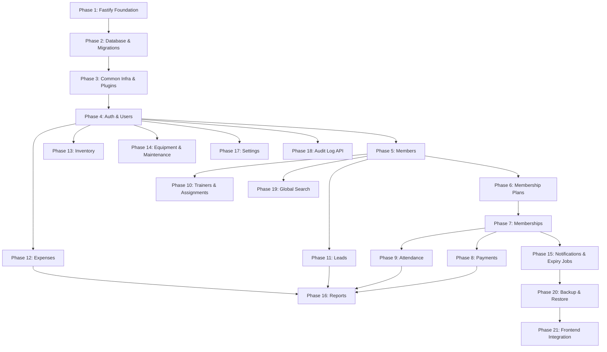

# 10 — Backend Development Plan

## Technology Baseline

```
Runtime:            Node.js 22 LTS
Language:           TypeScript 5 (ESM, "module": "NodeNext")
Framework:          Fastify 5.x
Architecture:       Modular Monolith
API:                REST
Persistence:        postgres (porsager/postgres) — tagged-template SQL, no ORM
Database:           PostgreSQL 15+
Migration tool:     node-pg-migrate (SQL-first versioned files)
Authentication:     @fastify/jwt + @fastify/cookie (signed JWT in httpOnly cookie)
API documentation:  @fastify/swagger + @fastify/swagger-ui (OpenAPI from TypeBox schemas)
Testing:            Vitest + app.inject() + Testcontainers (@testcontainers/postgresql)
Package manager:    pnpm
Build:              tsc → dist/ (dev loop: tsx watch src/server.ts)
```

---

## Implementation Dependency Graph



---

## Phase 1 — Fastify Foundation

**Objective:** Bootstrapped, buildable Fastify + TypeScript project with no domain code yet.

**Work:**
- Initialize `backend/` with pnpm:
  - `package.json` with `"type": "module"`, scripts (`dev`, `build`, `start`, `test`).
  - `tsconfig.json` with `"module": "NodeNext"`, `"moduleResolution": "NodeNext"`, `"target": "ES2023"`, `"strict": true`.
  - Install deps: `fastify`, `@fastify/type-provider-typebox`, `@sinclair/typebox`, `env-schema`, `pino-pretty` (dev), `tsx` (dev), `typescript`, `vitest`.
- Create `src/server.ts` + `src/app.ts`:
  - `app.ts` exports a `buildApp()` function that returns a configured Fastify instance (no `.listen()` — so tests can call `app.inject()`).
  - `server.ts` calls `buildApp()` and then `app.listen({ host: '0.0.0.0', port: env.PORT })`.
- Create `src/config/env.ts` with `env-schema` + TypeBox env schema (NODE_ENV, PORT, LOG_LEVEL).
- Implement `GET /health` route (no auth, returns `{ status: 'ok', uptime: process.uptime() }`).
- Set up Pino logger config (pretty in dev, JSON in prod).
- Add a baseline `.gitignore` and `.env.example`.

**Completion criteria:**
- `pnpm dev` starts without errors; logs show `server listening on port 8080`.
- `curl http://localhost:8080/health` returns `200 { "status": "ok", ... }`.
- `pnpm build` emits `dist/`; `node dist/server.js` runs the compiled artifact.
- `pnpm test` runs an empty Vitest suite successfully.

---

## Phase 2 — Database & Migrations

**Objective:** All database tables, types, constraints, and indexes created via versioned migrations.

**Dependencies:** Phase 1

**Work:**
- Install `postgres` (porsager/postgres) and `node-pg-migrate`.
- Create `src/db/client.ts`:
  - Instantiates a single `postgres(DATABASE_URL, { max: DATABASE_POOL_MAX, transform: { ...optional snake_case→camelCase } })` client.
  - Exports the `sql` singleton.
- Create a Fastify plugin that decorates the app with `app.sql` for route handlers.
- Add npm scripts: `migrate:up`, `migrate:down`, `migrate:create`.
- Write migration files in dependency order (one feature per file is fine, or group as below):
  1. `001_create_enum_types.sql` — all PostgreSQL enum types
  2. `002_create_users.sql`
  3. `003_create_gym_settings.sql` + seed row
  4. `004_create_members.sql`
  5. `005_create_membership_plans.sql`
  6. `006_create_memberships.sql` + partial unique index
  7. `007_create_payments.sql`
  8. `008_create_attendance.sql` + unique constraint
  9. `009_create_trainers.sql`
  10. `010_create_member_trainer_assignments.sql` + partial unique index
  11. `011_create_leads.sql`
  12. `012_create_expense_categories.sql`
  13. `013_create_expenses.sql`
  14. `014_create_inventory_categories.sql`
  15. `015_create_inventory_items.sql`
  16. `016_create_inventory_transactions.sql`
  17. `017_create_equipment_categories.sql`
  18. `018_create_equipment.sql`
  19. `019_create_equipment_maintenance.sql`
  20. `020_create_notification_records.sql`
  21. `021_create_audit_logs.sql`
  22. `022_create_code_sequences.sql` — all `_code_seq` sequences
- Add Testcontainers test setup: a Vitest `globalSetup` that starts a `PostgreSqlContainer`, runs migrations, and exposes the connection string to tests.

**Completion criteria:**
- `pnpm migrate:up` applies all 22 migrations on an empty DB without error.
- `pnpm migrate:up` is idempotent (second run says "no migrations to apply").
- All tables exist with correct columns, types, constraints.
- Partial unique indexes exist and can be verified via `\d+ memberships` in `psql`.
- A smoke Vitest test (Testcontainers) connects, runs migrations, inserts a dummy row.

---

## Phase 3 — Common Infrastructure & Plugins

**Objective:** Shared modules and Fastify plugins that all feature modules will depend on.

**Dependencies:** Phase 2

**Work:**
- **`src/common/errors.ts`**:
  - `AppError` base class with `code`, `httpStatus`, `message`, `details`.
  - `NotFoundError` (404), `ConflictError` (409), `BusinessRuleError` (422), `ForbiddenError` (403).
- **`src/common/pagination.ts`**:
  - `PageMeta`, `PageResponse<T>` TypeBox helpers.
  - `parsePageQuery(q)`, `toPageMeta(page, pageSize, total)`.
- **`src/common/codegen.ts`**:
  - `codegen.nextMemberCode(sql)`, `nextUserCode(sql)`, etc. — uses `nextval()` from Postgres sequences.
- **`src/common/audit.ts`**:
  - `auditLog(tx, { actorId, action, entityType, entityId, status, metadata })` helper.
  - String literal unions for `AuditAction`, `AuditEntityType`, `AuditStatus` (in `audit-types.ts`).
- **`src/common/permissions.ts`**:
  - `Permission` string literal union (full 40+ permissions).
  - `UserRole` string literal union.
  - `PERMS: Record<UserRole, ReadonlySet<Permission>>` static map.
  - `hasPermission(role, perm)` function.
- **`src/plugins/error-handler.ts`**:
  - `app.setErrorHandler(...)` mapping `AppError`, `err.validation`, `postgres` driver errors, and generic errors to the standard `ApiError` response.
- **`src/plugins/auth.ts`** (skeleton):
  - Registers `@fastify/cookie` and `@fastify/jwt`.
  - Decorates `app.requireAuth` (verifies JWT from cookie, 401 on failure).
  - Decorates `app.requirePermission(perm)` (checks role, 403 on failure).
  - Full user lookup wired in Phase 4.
- **`src/plugins/cors.ts`**:
  - Registers `@fastify/cors` with `origin: env.FRONTEND_ORIGIN`, `credentials: true`.
- **`src/plugins/csrf.ts`**:
  - Registers `@fastify/csrf-protection`.
- **`src/plugins/scheduler.ts`** (empty for now):
  - Will register `node-cron` jobs once notification module exists.
- **`src/plugins/swagger.ts`**:
  - Registers `@fastify/swagger` + `@fastify/swagger-ui` at `/docs` with `jsonSchemaTransform`.

**Tests:**
- Error handler maps `NotFoundError` → `404` with correct `ApiError` shape.
- Error handler maps a TypeBox validation failure → `400 VALIDATION_ERROR` with field details.
- Error handler maps `postgres` `code: '23505'` → `409 UNIQUE_CONSTRAINT_VIOLATION`.
- `codegen.nextMemberCode` generates `MEM-001`, `MEM-002`, etc. (uses Testcontainers DB with sequences).
- `hasPermission(role, perm)` returns correct booleans for a representative set of role/permission pairs.

**Completion criteria:**
- All common modules and plugins compile and pass tests.
- `ApiError` shape matches the frontend `ApiErrorData` interface.
- Error handler plugin is registered in `buildApp()` and catches thrown errors.

---

## Phase 4 — Authentication & Users

**Objective:** Working login/logout, JWT cookie issuance, and user CRUD. Gate for all other features.

**Dependencies:** Phase 3

**Tables:** `users` (migration already created in Phase 2)

**APIs implemented:**
- `POST /api/v1/auth/login`
- `POST /api/v1/auth/logout`
- `GET /api/v1/auth/me`
- `PATCH /api/v1/auth/profile`
- `GET /api/v1/users` (paginated, filter by role/status)
- `GET /api/v1/users/:id`
- `POST /api/v1/users`
- `PATCH /api/v1/users/:id`
- `DELETE /api/v1/users/:id`

**Business logic:**
- bcrypt password hashing via `@node-rs/bcrypt` with cost factor 12.
- JWT signed with `JWT_SECRET`, delivered via httpOnly cookie (`SameSite=Strict`, `Secure` in prod).
- `authService.login()`, `logout()`, `getCurrentUser()`.
- `userRepository.findByEmail`, `findById`, `findPage`, `insert`, `update`, `softDelete`.
- `preHandler: [app.requireAuth, app.requirePermission('users:create')]` on all user management routes.
- INACTIVE user login rejection → `403 AUTH_ACCOUNT_INACTIVE`.
- `last_login_at` updated on successful login.
- User code generation (`USR-NNN`).
- Audit log for LOGIN, LOGOUT, CREATE, UPDATE, DELETE.
- CSRF protection applied to all `POST /auth/*` endpoints except `/auth/login` itself (which uses rate-limiting instead).

**Schemas (TypeBox):**
- `LoginRequest`, `AuthUserResponse`
- `CreateUserRequest`, `UpdateUserRequest`, `UserResponse`, `UserListItemResponse`

**Tests (Vitest + `app.inject()`):**
- Login with valid credentials → 200, `Set-Cookie: token=...` present.
- Login with wrong password → 401 `AUTH_INVALID_CREDENTIALS`.
- Login with INACTIVE user → 403 `AUTH_ACCOUNT_INACTIVE`.
- Access protected endpoint without cookie → 401 `UNAUTHENTICATED`.
- RECEPTIONIST calling `POST /users` → 403 `FORBIDDEN`.
- OWNER can `DELETE /users/:id`; ADMIN cannot → 403.
- Create user with duplicate email → 409.
- Rate limit on login: 6th attempt in a minute → 429.

**Completion criteria:**
- Login/logout work end-to-end via `app.inject()`.
- All 4 roles can authenticate; permission checks fire correctly.
- User CRUD works for all permitted roles.
- Audit records visible in `audit_logs` table after each operation.

---

## Phase 5 — Members

**Objective:** Core member management.

**Dependencies:** Phase 4

**Table:** `members`

**APIs implemented:**
- `GET /api/v1/members` (paginated, search, status filter)
- `GET /api/v1/members/:id`
- `GET /api/v1/members/:id/details` (skeleton — returns empty supplemental data until Phase 7+)
- `POST /api/v1/members`
- `PATCH /api/v1/members/:id`
- `DELETE /api/v1/members/:id`

**Business logic:**
- Phone uniqueness (service `SELECT EXISTS` check + DB constraint).
- Phone format validation (`Type.String({ pattern: '^\\d{10}$' })`).
- DOB past-date validation (TypeBox `format: 'date'` + service check that date ≤ today in IST).
- Member code generation (`MEM-NNN`).
- Audit log for CREATE, UPDATE, DELETE inside `sql.begin()`.

**Schemas:** `CreateMemberRequest`, `UpdateMemberRequest`, `MemberListItemResponse`, `MemberDetailResponse`

**Tests:**
- Duplicate phone → 409 `MEMBER_PHONE_DUPLICATE`.
- Future DOB → 400.
- Delete member with no dependents → 204.
- Delete member with memberships → 409 (FK violation via `postgres` driver `code: '23503'`).
- Search by name / phone / `memberCode` returns correct results.

---

## Phase 6 — Membership Plans

**Objective:** Plan catalog management.

**Dependencies:** Phase 4 (auth only)

**Table:** `membership_plans`

**APIs implemented:**
- `GET /api/v1/membership-plans`
- `GET /api/v1/membership-plans/:id`
- `POST /api/v1/membership-plans`
- `PATCH /api/v1/membership-plans/:id`
- `DELETE /api/v1/membership-plans/:id`

**Business logic:**
- `Type.Integer({ minimum: 1 })` on `durationInDays`.
- `Type.Number({ exclusiveMinimum: 0 })` on `price` (or string pattern for DECIMAL).
- Delete blocked when active memberships reference the plan.

**Tests:**
- `durationInDays = 0` → 400.
- `price = 0` → 400.
- Delete plan with referenced memberships → 409.
- INACTIVE plan cannot be used in membership creation (verified in Phase 7).

---

## Phase 7 — Memberships

**Objective:** Core member subscription lifecycle.

**Dependencies:** Phases 5 (members) + 6 (plans)

**Table:** `memberships`

**APIs implemented:**
- `GET /api/v1/memberships` (paginated, filter by status/memberId)
- `GET /api/v1/memberships/:id`
- `POST /api/v1/memberships`

**Business logic:**
- `endDate = startDate + plan.durationInDays`.
- Snapshot `planName` and `amount` at creation (stored as columns on `memberships`).
- One-active-membership enforcement: service `SELECT EXISTS WHERE status='ACTIVE'` check + partial unique index.
- `sql.begin()`: membership INSERT + audit INSERT.

**Tests:**
- Create membership → correct `endDate` computed.
- Create second active membership → 409 `MEMBERSHIP_ALREADY_ACTIVE`.
- Using INACTIVE plan → 422 `PLAN_INACTIVE`.
- `GET /members/:id/details` now includes membership history.

---

## Phase 8 — Payments

**Objective:** Financial transaction recording.

**Dependencies:** Phase 7 (memberships)

**Table:** `payments`

**APIs implemented:**
- `GET /api/v1/payments` (paginated, filters)
- `GET /api/v1/payments/:id`
- `POST /api/v1/payments`

**Business logic:**
- `exclusiveMinimum: 0` on `amount`.
- Standalone payment (no `membershipId`) is valid.
- `sql.begin()`: payment INSERT + audit INSERT.

**Tests:**
- `amount = 0` → 400.
- Standalone payment → 201.
- Payment appears in `GET /members/:id/details` payment history.

---

## Phase 9 — Attendance

**Objective:** Daily check-in tracking.

**Dependencies:** Phase 7 (memberships), Phase 17 (settings — needed for attendance policy)

**Note:** Implement `settingsRepository` as a read-only stub in this phase if Phase 17 has not been completed. The `allowAttendanceForExpiredMembership` check requires settings.

**Table:** `attendance`

**APIs implemented:**
- `GET /api/v1/attendance` (paginated, filters)
- `POST /api/v1/attendance`

**Business logic:**
- `UNIQUE(member_id, attendance_date)` duplicate prevention.
- Settings policy check for expired members.
- `sql.begin()`: attendance INSERT + audit INSERT.

**Tests:**
- Duplicate attendance → 409 `ATTENDANCE_ALREADY_MARKED`.
- Expired membership + policy disallows → 422.
- Expired membership + policy allows → 201.

---

## Phase 10 — Trainers & Assignments

**Objective:** Trainer management and member-trainer assignment lifecycle.

**Dependencies:** Phase 5 (members)

**Tables:** `trainers`, `member_trainer_assignments`

**APIs implemented:**
- Full Trainers CRUD
- `GET /api/v1/members/:memberId/trainer`
- `POST /api/v1/members/:memberId/trainer`
- `DELETE /api/v1/members/:memberId/trainer`

**Business logic:**
- One-active-assignment per member (partial unique index + service check).
- New assignment auto-ends previous ACTIVE assignment inside the same transaction.
- `sql.begin()`: end-previous + insert-new + audit.

**Tests:**
- Assign second trainer → previous ENDED, new ACTIVE.
- End assignment → assignment ENDED with `endDate`.
- Delete trainer with ACTIVE assignment → 409 (FK).

---

## Phase 11 — Leads

**Objective:** Lead pipeline management and lead-to-member conversion.

**Dependencies:** Phase 5 (members)

**Table:** `leads`

**APIs implemented:**
- Full Leads CRUD
- `POST /api/v1/leads/:id/convert`

**Business logic:**
- Lead code generation (`LEAD-NNN`).
- Atomic conversion: lead UPDATE + member INSERT + 2× audit INSERT inside one `sql.begin()`.
- Cannot convert already-CONVERTED lead → 409.
- Phone uniqueness check on conversion.

**Tests:**
- Convert lead → member created, lead CONVERTED, `convertedMemberId` populated.
- Convert already-converted lead → 409 `LEAD_ALREADY_CONVERTED`.
- Duplicate phone on conversion → 409 `MEMBER_PHONE_DUPLICATE`.

---

## Phase 12 — Expenses

**Dependencies:** Phase 4 (auth)

**Tables:** `expenses`, `expense_categories`

**APIs implemented:**
- Expense categories CRUD
- Expenses CRUD

**Business logic:** Category active check, `amount > 0`.

---

## Phase 13 — Inventory

**Dependencies:** Phase 4 (auth)

**Tables:** `inventory_items`, `inventory_transactions`, `inventory_categories`

**APIs implemented:**
- Inventory categories CRUD
- Inventory items CRUD
- `GET /api/v1/inventory/:id/transactions`
- `POST /api/v1/inventory/:id/transactions`

**Business logic:**
- `currentStock` updated atomically.
- `status` derived and stored.
- `STOCK_OUT` rejected if stock would go negative.
- `SELECT ... FOR UPDATE` inside `sql.begin()` to serialize concurrent writes on the same item.

**Tests:**
- `STOCK_OUT` exceeding stock → 422 `INVENTORY_INSUFFICIENT_STOCK`.
- Concurrent `STOCK_OUT` requests do not produce negative stock (Testcontainers + two parallel `sql.begin()` calls).

---

## Phase 14 — Equipment & Maintenance

**Dependencies:** Phase 4 (auth)

**Tables:** `equipment`, `equipment_maintenance`, `equipment_categories`

**APIs implemented:**
- Equipment categories CRUD
- Equipment CRUD
- `GET /api/v1/equipment/:id/maintenance`
- `POST /api/v1/equipment/:id/maintenance` (append-only)

**Business logic:** Equipment code generation. Maintenance records append-only (no edit/delete endpoint).

---

## Phase 15 — Notifications & Expiry Jobs

**Dependencies:** Phase 7 (memberships)

**Table:** `notification_records`

**APIs implemented:**
- `GET /api/v1/notifications`
- `GET /api/v1/notifications/expiring`
- `GET /api/v1/notifications/expired`
- `POST /api/v1/notifications`

**Business logic:**
- Expiry window query (7 / 14 / 30 days).
- `node-cron` jobs registered inside `plugins/scheduler.ts`:
  - Midnight IST (`'0 0 * * *'`, timezone `Asia/Kolkata`): expire ACTIVE memberships, update member status.
  - 9 AM IST (`'0 9 * * *'`, timezone `Asia/Kolkata`): send expiry notifications.
- Jobs call into `modules/notification/service.ts` and share the same `sql` client.

**Tests:**
- Expiry job transitions correct memberships to EXPIRED (invoked directly, not via cron).
- Notification records created for expiring memberships.

---

## Phase 16 — Reports

**Dependencies:** Phases 8 (payments), 9 (attendance), 11 (leads), 12 (expenses)

**APIs implemented:** All 7 report endpoints (see `05-api-design.md`)

**Business logic:**
- Read-only — no transaction needed; queries run on the top-level `sql` client.
- Revenue = `SUM(amount)` of `COMPLETED` payments in range.
- Net cash flow = Revenue − Expenses.
- All date comparisons use IST (`formatInTimeZone(..., 'Asia/Kolkata', 'yyyy-MM-dd')`).

**Tests:**
- Revenue report returns correct sum.
- Empty date range returns zeros.
- Net cash flow calculation correct.

---

## Phase 17 — Settings

**Dependencies:** Phase 4 (auth)

**Table:** `gym_settings` (singleton: `id = 1`)

**APIs implemented:**
- `GET /api/v1/settings`
- `PATCH /api/v1/settings`

**Business logic:** Singleton upsert. `attendanceEndTime > attendanceStartTime`. OWNER-only write.

---

## Phase 18 — Audit Log API

**Dependencies:** Phase 3 (audit helper already writing from each feature)

**APIs implemented:**
- `GET /api/v1/audit-logs` (paginated, filterable)
- `GET /api/v1/audit-logs/:id`

**Business logic:** Read-only. No CREATE / UPDATE / DELETE routes exposed. The DB role should not have `DELETE` privilege on `audit_logs` as an additional defense layer.

---

## Phase 19 — Global Search

**Dependencies:** Phase 5 (members) and others as needed

**APIs implemented:**
- `GET /api/v1/search?q=...`

**Business logic:** Permission-aware parallel queries (`Promise.all`), max 5 per category, `ILIKE` matching, min 2 char query.

---

## Phase 20 — Backup & Restore

**Dependencies:** Phases 1–18 complete (stable schema)

**APIs implemented:**
- `POST /api/v1/backup/create` — spawns `pg_dump` via `child_process.spawn`, writes to `env.BACKUP_DIR`.
- `GET /api/v1/backup/list`
- `POST /api/v1/backup/restore` — accepts uploaded `.sql`, spawns `psql`.

**Note:** Frontend UI for backup/restore is not yet implemented.

---

## Phase 21 — Frontend Integration

**Objective:** Connect the React frontend to the real backend by replacing mock repositories.

**Work (per `frontend-integration.md` checklist):**
- Confirm `VITE_API_BASE_URL` and that `apiClient` sends cookies (`credentials: 'include'`) and attaches `X-CSRF-Token` on state-changing requests.
- Implement `AuthTransport` interface in `AuthContext`.
- Replace mock repositories with API repositories per domain.
- Convert hooks to TanStack Query `useQuery` / `useMutation`.
- Handle `isLoading` and `isError` states in page components.
- End-to-end test each feature.

---

## Per-Phase Deliverable Checklist

Each phase should produce:

```
[ ] Migration file(s) (if new tables)
[ ] Repository module (SQL functions, accepting sql | tx)
[ ] TypeBox schemas (request + response, with exported Static<> types)
[ ] Service module with business logic + sql.begin() where needed
[ ] Routes module registering the Fastify plugin with preHandler + schema
[ ] Domain-specific error class(es) if new error conditions
[ ] Vitest unit tests for service business rules
[ ] Vitest route tests via app.inject() covering auth, permission, validation, happy path, each error path
[ ] Testcontainers test for any new DB constraints or partial indexes
[ ] auditLog() called inside sql.begin() for all mutations
[ ] API endpoints match 05-api-design.md contract
```

---

## Design Review Checklist

```
[ ] Requirements reviewed
[ ] Domain model reviewed
[ ] Business rules reviewed
[ ] Architecture reviewed (Fastify modular monolith)
[ ] Database design reviewed
[ ] API contract reviewed
[ ] Authentication design reviewed (cookie-JWT; TTL decided)
[ ] Authorization design reviewed (permission matrix + requirePermission wiring)
[ ] Cross-cutting concerns reviewed
[ ] Deployment design reviewed
[ ] Backend implementation order reviewed
[ ] Open decisions resolved
```

---

## Open Decisions

Stack-level decisions (Spring vs Fastify, Java vs TypeScript, Maven vs pnpm, Flyway vs node-pg-migrate, session vs JWT) are **resolved** by the Fastify pivot and no longer appear here. What remains are decisions that are genuinely still open under the chosen stack.

| # | Decision | Blocks | Recommendation |
|---|---|---|---|
| 1 | **Session TTL**: 8h (one shift) vs 24h (one day) | Phase 4 | 8h; staff re-login once per shift is acceptable for a LAN app |
| 2 | **Test runner**: Vitest vs Node's built-in `node:test` | Phase 1 | Vitest — watch mode, rich assertions, mature ecosystem; `node:test` revisit if dependency footprint becomes a concern |
| 3 | **Query builder on top of `postgres`** (e.g., Kysely) | Phase 2+ | Skip for v1. Raw tagged templates are readable for the ~50 queries in this app. Revisit only if queries become repetitive or type-unsafe |
| 4 | **Audit log diff representation**: JSON before/after snapshots vs change-set diff | Phase 3 | Change-set diff (only changed fields) stored as JSONB in `metadata`; smaller rows, easier to display |
| 5 | **snake_case → camelCase mapping**: driver-level `transform` option vs explicit per-service mapping | Phase 2 | Driver-level `transform` for `undefined → null` and `snake → camel` on columns; explicit mapping for response shaping (date formatting, enum narrowing) |
| 6 | **HTTPS on LAN**: self-signed cert vs plain HTTP | Phase 1 | HTTPS with self-signed cert installed on staff machines; prevents credential interception from other LAN devices |
| 7 | **Backup external storage**: external drive vs cloud (e.g., Backblaze B2) | Phase 20 | External USB drive rotated weekly for v1; cloud optional if the gym has reliable internet |
| 8 | **Backup frontend UI**: not yet implemented | Phase 20/21 | Backend API shipped in Phase 20; frontend integration tracked as a separate task after Phase 21 |
| 9 | **Password reset flow**: admin-set vs email-based self-service | Phase 4 | Admin-set (an OWNER/ADMIN can reset any user's password); no SMTP dependency for v1 |
| 10 | **Payment idempotency key**: supported from v1 vs deferred | Phase 8 | Deferred. The payment UI is operated by one receptionist at a time; double-submit is unlikely. Revisit if an external POS integration is added |
| 11 | **Frontend serving**: Fastify `@fastify/static` vs separate Nginx | Deployment | `@fastify/static` on the same port. One process to supervise. Nginx only if HTTPS termination needs to be decoupled |
